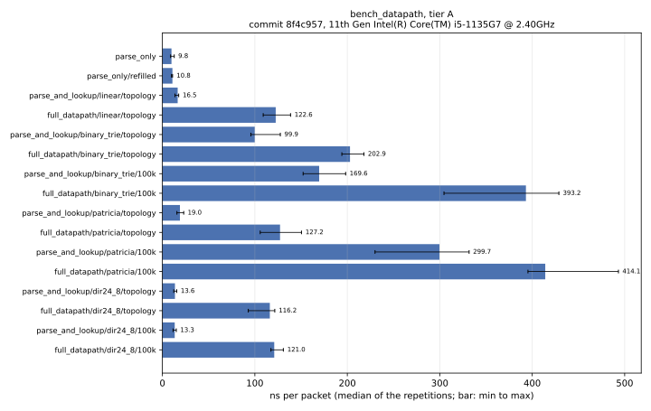
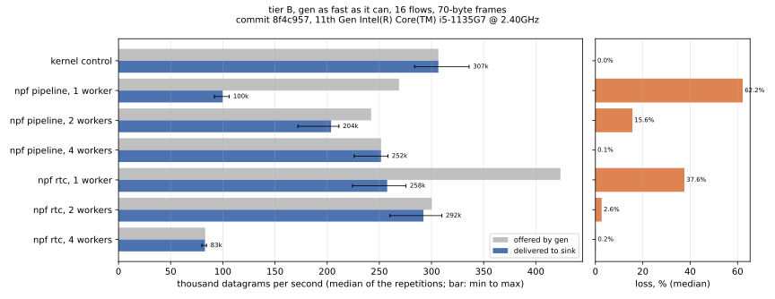
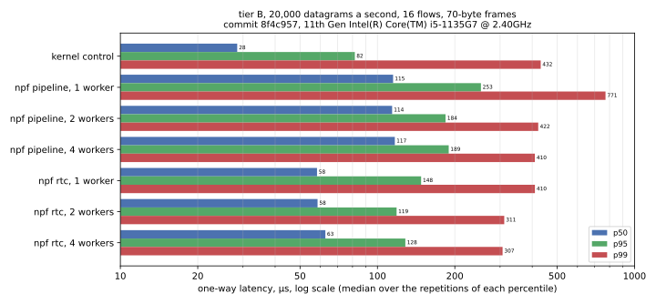
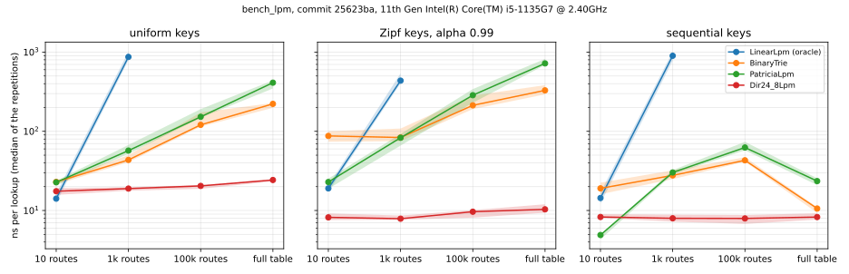

# Performance

Every number in this file is the output of a run on the machine described below; the JSON each
table came from is in `bench/results/`. Nothing here is estimated or rounded up. What a set of
numbers does *not* measure is stated next to it. The methodology below holds for every entry from
phase 14 on; phases 3 and 10, which came before the harness, say how each was run.

## Methodology

Since phase 14, `scripts/run_bench.sh` takes every measurement, the same way each time, and
`scripts/bench_combine.py` turns one run into one file, `bench/results/<date>-<sha>.json`: the
evidence each table below comes from. That file also records what CLAUDE.md §9 asks of every
result: git SHA, ISO date, `uname -r`, the CPU model from `lscpu`, the compiler and its version, the
CMake preset and the exact compile command, the burst size and pool size, the worker counts, and
whether `perf stat -e cycles` succeeded. `bench_combine.py` refuses to write a run with a NaN, a
benchmark error, or a zero where a measurement belongs.

```bash
git clean -xdf -e data -e .deps-cache
cmake --preset bench && cmake --build --preset bench -j
sudo ./scripts/run_bench.sh --all
python3 bench/plot.py
```

`git clean` keeps `data/`, the RouteViews table `scripts/fetch_bgp_table.sh` downloads, and
`.deps-cache/`, GoogleTest and Google Benchmark: neither changes what is measured, and both are
slow to fetch again.

### Two tiers, never mixed

**Tier A** measures code: the forwarding logic in process, with no I/O at all, in Google Benchmark.

- `bench_datapath`:
  - 1024 UDP frames of 70 bytes, built once in a packet pool and walked in bursts of 32 over 16
    flows, so every iteration is one burst.
  - `parse_only` runs the Ethernet, IPv4 and L4 parsers.
  - `parse_and_lookup/<fib>/<size>` adds a FIB lookup of each destination.
  - `full_datapath/<fib>/<size>` calls the real `Forwarder::process_burst`, all fourteen steps of
    ARCHITECTURE.md §11, rewrite and incremental checksum included. Every frame of a lap must be
    forwarded, before timing and after, or the benchmark fails.
  - `<fib>` is each of the four LPM tables; `<size>` is the three routes of
    `configs/router.conf`, or those plus the 100k sample of the RouteViews table.
  - Forwarding rewrites a frame -- the next hop's MAC as destination, which the router would drop
    if it came round again -- so `full_datapath` restores all 1024 frames from pristine copies after
    each lap, with the timer and the cycle counter stopped. A pause leaves a little behind in the
    timings: `parse_only/refilled` is `parse_only` with the same pauses, and the difference between
    the two is that residue.
- `bench_pool`: one acquire and release, and a burst of 32 of each.
- `bench_ring`: one push and pop on one thread; a round trip between two threads through two
  rings; and bursts of 32 streamed from one thread to another.
- `bench_checksum` (phase 3) and `bench_lpm` (phase 10), as before.

Each benchmark is pinned with `taskset`: CPU 2, or CPUs 2 and 4 for the ring's two threads, which
`lscpu -e` puts on different cores. It runs 0.5 s of warm-up, then 7 repetitions, reported as
aggregates: mean, median, standard deviation, coefficient of variation, and p95 (nearest rank, so
the slowest of 7), min and max. Every benchmark starts once the one-minute load average is below
0.5. `bench_datapath` also counts the CPU's cycles in user mode through `perf_event_open`, and
reports cycles per packet. The `perf` tool itself is not installed (see Environment), but the
counters it would read are.

**Tier B** measures the whole router -- npf, the kernel under it, veth, two network namespaces --
by sending traffic through it. It is the topology of `scripts/setup_netns.sh`, with npf running
`configs/router.conf` (burst 32, pool 4096 per pool):

- `bench/system/gen`:
  - runs in ns-client, pinned to CPU 6;
  - sends 16 flows of 70-byte frames, the smallest that carry its payload, to 10.0.2.2 through a
    raw IP socket;
  - each datagram carries its flow, its sequence number and the time-stamp counter read just
    before `sendto()`.
- `bench/system/sink`:
  - runs in ns-server, pinned to CPU 7, on a UDP socket, reading with `recvmmsg()`;
  - counts what arrives, finds the gaps in each flow's sequence numbers, and takes each
    datagram's one-way latency as the TSC when it was received minus the TSC gen stamped;
  - both read the same counter on the same machine (`constant_tsc nonstop_tsc tsc_reliable`), and
    sink converts ticks to nanoseconds at the rate it measures against `CLOCK_MONOTONIC_RAW` over
    its whole run. A negative latency would mean the counter differs between CPUs; any one fails
    the run.
- npf runs confined to CPUs 0-5. That is the process's CPU mask, not a pin per thread, which
  phase 13 did not build.

Every configuration runs two scenarios:

- **throughput**: gen as fast as it can send.
- **latency**: gen at 20,000 datagrams a second, paced on the steady clock, a rate low enough that
  queues should stay empty.

Each scenario is a 2 s warm-up, then 5 repetitions of 10 s, each with a fresh sink. Per repetition
the run records:

- **offered**: what gen sent, per second;
- **delivered**: what sink received, per second of gen's run;
- **loss**: the share of what was sent that never arrived;
- **latency**: p50, p95, p99, p99.9 and max of every datagram's;
- **npf's CPU**: user plus system time from `/proc/<pid>/stat` over the repetition, as a share of
  one CPU, so 4 workers can reach 400%;
- **the machine's busy time**: from `/proc/stat`, as a share of all 8 CPUs.

Per configuration the run also records npf's peak RSS (`VmHWM`) and its final counters, which must
balance: `rx_packets == forwarded + flooded + to_host + every drop`.

The configurations:

- **the kernel control**: npf replaced by Linux's own forwarding on the same topology, with
  addresses on ns-router's veths, `net.ipv4.ip_forward=1`, and `arp_ignore` back to 0 so that the
  router's kernel answers ARP. It runs in a topology built for it and torn down afterwards, so
  nothing it changed survives into npf's runs. **It is the denominator**: a tier B number for npf
  means something only next to the kernel's on the same machine, the same day.
- **npf**: `--mode rtc` and `--mode pipeline`, each with 1, 2 and 4 workers.

### Reporting

Every number quoted is a median over the repetitions, with p95 and the spread from min to max
beside it, never a mean alone. A later change whose difference from the baseline lies inside the
baseline's spread is noise: the change is reverted, and the negative result is written down here.

[phase 15] Phase 15 compares changes by `scripts/ab_bench.sh`, whose before and after run
interleaved within the same minutes, and decides tier A by cycles per packet rather than wall time
(entries 0 to 14 below). Its entry 14 found that a run's own spread does not cover what a number
does from one session to the next: a rerun of the whole benchmark the same day reproduced 29 of 44
tier A numbers and 20 of 42 tier B ones inside the baseline's range. So, from phase 16 on:

- a tier B number is reported as the range across at least two sessions, and called reproduced
  only inside that range;
- a comparison is still made within one session, interleaved, as phase 15's were;
- `scripts/bench_reproduce.py` checks a rerun against a baseline, number by number.

### What these numbers do not measure

- **A NIC.**
  - veth hands a frame from one namespace to another in memory, with no wire, no interrupt
    moderation and no DMA.
  - On veth the kernel's own forwarding runs in the softirq of the sending CPU: most of the
    kernel control's work lands on gen's CPU 6. That shows in the machine's busy time, and in no
    process's CPU time.
- **npf's peak rate, when gen is slower.**
  - One gen thread on one raw socket is the only source, so the throughput scenario offers what
    gen can send through the configuration under test, not what the router could take.
  - On veth, gen's own `sendto()` pays for part of the receiving side's work, so the offered rate
    itself depends on the configuration.
  - Delivered rates are comparable as delivered rates. Where offered and delivered are equal and
    loss is zero, the router was not the bottleneck, and its capacity was not reached.
- **The router's latency alone.** Latency is one way from gen's `sendto()` to sink's return from
  `recvmmsg()`: both kernels' network stacks, npf or the kernel's forwarding between them, and
  sink's own scheduling. sink reads the TSC once per batch of up to 64 datagrams, so a datagram's
  latency includes the wait for the rest of its batch. That is none at 20,000 a second, and more
  under the throughput scenario's load.
- **Bare metal.** This is WSL2: a Hyper-V virtual machine on a Windows laptop whose clock follows
  turbo and the power plan, with other Windows processes beside it. The repetitions and their
  spread show how much that moved the numbers; they cannot remove it.
- **Tier A numbers as tier B.** A tier A time is the forwarding code's, with every frame and table
  in cache, or as much of them as fits. It says nothing about packets per second through
  interfaces, and a tier B number says nothing about the code.

## Environment

Recorded 2026-09-30.

| | |
|---|---|
| CPU | 11th Gen Intel Core i5-1135G7 @ 2.40 GHz, 4 cores / 8 threads |
| Caches (as reported by Google Benchmark) | L1d 48 KiB ×4, L1i 32 KiB ×4, L2 1280 KiB ×4, L3 8192 KiB |
| Host | Windows 11 laptop on mains power, power plan "Balanced" |
| Guest | WSL2, kernel `6.6.87.2-microsoft-standard-WSL2`, Ubuntu 24.04 |
| Compiler | GCC 13.3.0 |

### Hardware performance counters: available

`CLAUDE.md` §3 asks for this to be checked once and recorded. The `perf` tool is not installed:
Ubuntu's `linux-tools` packages are built for Ubuntu kernels, not the WSL kernel. The check used the
system call `perf` itself uses instead: `perf_event_open` with `PERF_TYPE_HARDWARE`, counting user
space only (`exclude_kernel = 1`), which `kernel.perf_event_paranoid = 2` allows without privileges.

Over a 10,000,000-iteration loop it counted **60,000,036 instructions** and 51,169,370 cycles. The
kernel also lists `branch-instructions`, `branch-misses`, `bus-cycles`, `cache-misses`,
`cache-references`, `cpu-cycles`, `instructions` and `ref-cycles` under
`/sys/bus/event_source/devices/cpu/events`. Counting kernel-mode events, and the `perf` tool itself,
were not tried.

## Phase 14: baseline (both tiers)

**Run.** `bench/results/2026-10-14-8f4c957.json`, written by
`sudo ./scripts/run_bench.sh --all` on 2026-10-14 (UTC):

- **Code:** commit `8f4c957`, built from a tree cleaned with `git clean -xdf -e data -e .deps-cache`.
- **Build:** the `bench` preset, GCC 13.3.0, `-O2 -g -DNDEBUG -std=c++20 -march=native` and the
  project's warning flags. The JSON keeps the exact compile command.
- **Machine:** same as above. The `perf` tool is still not installed, so `perf stat -e cycles`
  failed. The counters work through `perf_event_open`.
- **Duration:** the run took 27 minutes.
- **Load:**
  - The script started each tier A benchmark once the one-minute load average was below 0.5.
  - Google Benchmark, which reads it a moment later with that benchmark's data loaded, recorded
    between 0.47 and 0.61.

### Tier A: the forwarding code

`bench_datapath`, per packet. Each iteration is a burst of 32, and its time is divided by 32.
Medians of 7 repetitions, p95 (the slowest of the 7), the range, and user-mode cycles per packet:

| Benchmark | Median ns/packet | p95 | Min – max | Cycles/packet (median) |
|---|---:|---:|---:|---:|
| `parse_only` | 9.8 | 12.8 | 8.8 – 12.8 | 26 |
| `parse_only/refilled` | 10.8 | 11.0 | 9.9 – 11.0 | 25 |
| `parse_and_lookup/linear/topology` | 16.5 | 17.6 | 13.6 – 17.6 | 38 |
| `full_datapath/linear/topology` | 122.6 | 138.6 | 109.0 – 138.6 | 289 |
| `parse_and_lookup/binary_trie/topology` | 99.9 | 127.5 | 95.7 – 127.5 | 248 |
| `full_datapath/binary_trie/topology` | 202.9 | 218.0 | 194.1 – 218.0 | 480 |
| `parse_and_lookup/binary_trie/100k` | 169.6 | 198.2 | 152.2 – 198.2 | 458 |
| `full_datapath/binary_trie/100k` | 393.2 | 428.8 | 304.6 – 428.8 | 813 |
| `parse_and_lookup/patricia/topology` | 19.0 | 23.0 | 15.7 – 23.0 | 45 |
| `full_datapath/patricia/topology` | 127.2 | 150.4 | 105.8 – 150.4 | 303 |
| `parse_and_lookup/patricia/100k` | 299.7 | 331.7 | 230.0 – 331.7 | 632 |
| `full_datapath/patricia/100k` | 414.1 | 493.3 | 395.4 – 493.3 | 1006 |
| `parse_and_lookup/dir24_8/topology` | 13.6 | 15.5 | 12.3 – 15.5 | 33 |
| `full_datapath/dir24_8/topology` | 116.2 | 121.5 | 92.9 – 121.5 | 287 |
| `parse_and_lookup/dir24_8/100k` | 13.3 | 15.0 | 11.5 – 15.0 | 34 |
| `full_datapath/dir24_8/100k` | 121.0 | 130.8 | 117.4 – 130.8 | 300 |

What the table shows:

- **The steps beyond parsing and lookup are most of the cost of a forwarded packet.**
  - With DIR-24-8 and the topology's routes, `full_datapath` is 116.2 ns and 287 cycles per
    packet. Parsing plus the lookup is 13.6 ns and 33 cycles of that, which leaves 102.6 ns and
    254 cycles.
  - That remainder covers the rest of the fourteen steps of ARCHITECTURE.md §11: the checksum
    check, the martian and local-address checks, the filter, the ARP lookup, the rewrite with its
    incremental checksum, and the burst's bookkeeping.
  - Which of these costs what was not measured. It is the first candidate below.
- **The table's size matters only for the tries.**
  - DIR-24-8's parse and lookup takes 13.6 ns with the topology's 3 routes and 13.3 ns with 100k
    routes.
  - The binary trie goes from 99.9 to 169.6 ns, and Patricia from 19.0 to 299.7 ns.
  - With 100k routes, `full_datapath` costs 121.0 ns on DIR-24-8 against 393.2 ns on the binary
    trie and 414.1 ns on Patricia.
- **The refill pause leaves little in the timings.** `parse_only/refilled`, which pauses as
  `full_datapath` does, has a median 1.0 ns per packet above `parse_only` (10.8 against 9.8). That
  is inside `parse_only`'s own range of 8.8 to 12.8 ns.

`bench_pool` and `bench_ring`. The burst benchmarks are per packet; the others are per operation,
and `ring_round_trip` is per round trip:

| Benchmark | Median ns per packet or operation | p95 | Min – max |
|---|---:|---:|---:|
| `pool_acquire_release` | 4.99 | 5.62 | 4.46 – 5.62 |
| `pool_acquire_release/burst` | 3.44 | 4.11 | 2.97 – 4.11 |
| `ring_push_pop` | 2.32 | 2.91 | 2.03 – 2.91 |
| `ring_round_trip/real_time/threads:2` | 155.72 | 227.26 | 94.52 – 227.26 |
| `ring_throughput/real_time/threads:2` | 2.26 | 2.49 | 1.91 – 2.49 |

- **A ring round trip between two cores** takes a median of 155.72 ns, with a range from 94.52 to
  227.26 ns over 7 repetitions: the widest spread in tier A.
- **Streamed in bursts of 32**, a packet costs 2.26 ns to pass from one thread to the other.

The run also repeated `bench_lpm` on the full RouteViews table. Its numbers are in the same JSON;
phase 10's section below remains the account of them.



### Tier B: the router, through the namespaces

**Throughput.** gen sends as fast as it can. Medians of 5 repetitions of 10 s, with the range of
delivered rate and loss. npf's CPU is a share of one CPU; the machine's busy time is a share of
all 8:

| Configuration | Offered, kpps | Delivered, kpps (min – max) | Loss, % (min – max) | npf CPU, % of one | Machine busy, % of 8 | npf peak RSS, MiB |
|---|---:|---:|---:|---:|---:|---:|
| kernel control | 306.6 | 306.6 (283.8 – 336.0) | 0.0 (0.0 – 0.0) | – | 19 | – |
| npf pipeline, 1 worker | 268.9 | 99.9 (91.9 – 106.1) | 62.2 (60.6 – 65.8) | 198 | 42 | 29.0 |
| npf pipeline, 2 workers | 242.2 | 203.8 (172.0 – 211.2) | 15.6 (11.4 – 16.1) | 297 | 57 | 37.9 |
| npf pipeline, 4 workers | 251.7 | 251.6 (225.9 – 258.2) | 0.1 (0.0 – 0.8) | 381 | 68 | 55.1 |
| npf rtc, 1 worker | 423.6 | 257.5 (224.3 – 275.5) | 37.6 (36.4 – 39.2) | 95 | 30 | 12.2 |
| npf rtc, 2 workers | 300.2 | 292.3 (260.2 – 309.9) | 2.6 (2.4 – 3.4) | 161 | 39 | 20.6 |
| npf rtc, 4 workers | 83.1 | 82.9 (79.9 – 84.4) | 0.2 (0.0 – 1.5) | 137 | 31 | 37.2 |



**Latency.** gen sends 20,000 datagrams a second. Medians over the 5 repetitions of each
percentile, with the range of the p50:

| Configuration | p50, µs (min – max) | p95, µs | p99, µs | p99.9, µs | npf CPU, % of one | Machine busy, % of 8 |
|---|---:|---:|---:|---:|---:|---:|
| kernel control | 28.5 (27.8 – 29.3) | 82 | 432 | 4269 | – | 13 |
| npf pipeline, 1 worker | 115.1 (103.6 – 118.8) | 253 | 771 | 3904 | 112 | 28 |
| npf pipeline, 2 workers | 114.1 (111.3 – 129.2) | 184 | 422 | 2656 | 145 | 32 |
| npf pipeline, 4 workers | 116.9 (113.3 – 138.8) | 189 | 410 | 2867 | 164 | 34 |
| npf rtc, 1 worker | 58.2 (56.7 – 58.9) | 148 | 410 | 3279 | 46 | 20 |
| npf rtc, 2 workers | 58.5 (58.2 – 58.8) | 119 | 311 | 3651 | 49 | 20 |
| npf rtc, 4 workers | 62.7 (61.7 – 65.5) | 128 | 307 | 2411 | 57 | 21 |



npf's own counters at the end of each configuration's ten repetitions, warm-ups and pings
included. They balanced in every configuration, and every buffer was back in its pool:

| Configuration | rx_packets | forwarded | RingFull |
|---|---:|---:|---:|
| npf pipeline, 1 worker | 14,992,507 | 6,232,392 | 8,760,110 |
| npf pipeline, 2 workers | 13,144,235 | 11,414,264 | 1,729,966 |
| npf pipeline, 4 workers | 13,944,240 | 13,942,079 | 2,156 |
| npf rtc, 1 worker | 14,260,892 | 14,260,887 | 0 |
| npf rtc, 2 workers | 16,176,433 | 16,176,428 | 0 |
| npf rtc, 4 workers | 5,337,316 | 5,337,312 | 0 |

What the tables show, and what they cannot:

- **The kernel control was not saturated.**
  - It delivered everything gen offered, 306.6 kpps at a median, with 0.0% loss in every
    repetition, so this run does not show the kernel's capacity.
  - The machine was 19% busy.
  - As the methodology says, on veth that work lands mostly on gen's own CPU.
- **Run-to-completion with 1 worker loses packets before npf ever sees them.**
  - gen offered 423.6 kpps; 257.5 kpps arrived, a loss of 37.6%.
  - Yet npf's counters show 14,260,892 packets received and 14,260,887 forwarded: the other five
    were the router's own (`to_host`), and none was dropped.
  - Every lost packet was lost in the kernel, before npf read it, most likely when a socket's
    receive buffer overflowed. npf has no counter for that, and the kernel's (`PACKET_STATISTICS`)
    was not read. It is a candidate below.
  - With 1 worker, npf used 95% of one CPU.
- **Pipeline mode with 1 worker drops what its one worker cannot take, and counts it.**
  - The RX threads received 14,992,507 packets and dropped 8,760,110 of them as `RingFull`.
  - With 2 workers that fell to 1,729,966; with 4, to 2,156, at 0.1% loss.
  - The RX threads are extra threads, and it shows in the CPU time: pipeline mode used 198% of a
    CPU with 1 worker, against 95% for run-to-completion with 1.
- **The offered rate is not the same from one configuration to the next.**
  - gen sent 423.6 kpps into npf with 1 run-to-completion worker, but 83.1 kpps into npf with 4.
  - With 4 workers, gen itself was slowed, by work it does on the receiving side's behalf
    (methodology), and npf delivered all but 0.2% of what it was given.
  - Why 4 workers cost the sender so much more than 1 or 2 was not measured. It is a candidate.
  - Delivered rates compare as delivered rates only: none of these configurations was driven to
    its own limit by a sender independent of it.
- **At 20,000 datagrams a second nothing was lost, and latency separates the models.**
  - The median one-way latency was 28.5 µs through the kernel, 58.2 µs through npf with 1
    run-to-completion worker, and 115.1 µs with pipeline mode's 1 worker.
  - Pipeline mode passes each packet through one more thread and one more wake-up.
  - Every configuration's p99.9 was in the milliseconds, the kernel's included: 4269 µs. A run
    this short on a virtual machine cannot say where those come from.
- **An idle-ish npf is not free.** At 20,000 datagrams a second npf used 46% of a CPU with 1
  run-to-completion worker, and 112% in pipeline mode with 1 worker. The machine was 13% busy
  with the kernel forwarding the same traffic.

### What this baseline does not measure

All of the methodology's list, and besides:

- **One run, on one day.** The spread shown is across the repetitions of this run. A second run
  might differ by more, especially in tier B, whose throughput ranges are wide: the kernel
  control's delivered rate ranged from 283.8 to 336.0 kpps.
- **Busy-polling.** npf ran with `poll()` and its 100 ms timeout, the default; `--busy-poll` was not
  measured.
- **Other frame sizes, flow counts or rates.** Only 70-byte frames, 16 flows, and the two rates.

## Phase 15: optimization pass

One change at a time, each measured before and after on the same machine, each its own commit
with its numbers. `docs/BUILD_PLAN.md` lists the candidates; the phase 14 baseline added its own.

**Method.** Tier A comparisons use `scripts/ab_bench.sh`:

- **Builds.** It builds the benchmark twice with the bench preset. The before side is a commit,
  checked out in a git worktree; the after side is the change, uncommitted. The result records
  the change's diff.
- **Order.** It runs them before, after, after, before: two rounds, so that drift during the run
  shows up as rounds that disagree.
- **Each run** is pinned to CPU 2, 7 repetitions, started once the load average is below 0.5.
- **Comparison.** `scripts/bench_compare.py` pools each side's 14 repetitions and reports, per
  metric:
  - the median, the min and the p95 (nearest rank, which of 14 is the slowest);
  - the delta between the medians;
  - the noise band, the larger of the two sides' p95 minus median;
  - each round's delta on its own.
- **The noise rule** (`docs/BUILD_PLAN.md`): a change is **noise** if its delta is smaller than
  the band, or if the two rounds disagree in sign. A change that is noise is reverted, and its
  entry stays.
- **The metric.** Tier A's primary metric is **cycles per packet**, counted in user mode through
  `perf_event_open`. Nanoseconds are reported beside it, but this laptop's clock follows turbo
  and the power plan, and its wall times wander too much to decide anything (entry 0).
- **Evidence.** Each comparison's JSON is `bench/results/<date>-<sha>-ab-<name>.json`, the four
  Google Benchmark runs inside it whole.

### Entry 0: the noise floor (no change)

**Before and after:** the same code, commit `e09965c`, built twice. Only the comparison tooling
differed, and it is not part of the benchmark.

| Benchmark, metric | Before: median (min – p95) | After: median (min – p95) | Delta | Noise band | Rounds | Verdict |
|---|---:|---:|---:|---:|---:|---|
| `parse_only`, cycles | 23.7 (23.0 – 26.0) | 25.3 (23.2 – 30.6) | +1.5 (+6.5%) | 5.3 | -1.5, +4.0 | NOISE |
| `parse_only`, ns | 6.3 (5.8 – 9.9) | 9.5 (5.9 – 20.0) | +3.2 (+50.0%) | 10.5 | -1.3, +8.8 | NOISE |
| `full_datapath/linear/topology`, cycles | 286.1 (283.4 – 315.5) | 285.9 (282.5 – 291.1) | -0.2 (-0.1%) | 29.4 | -2.2, +1.2 | NOISE |
| `full_datapath/linear/topology`, ns | 88.4 (81.2 – 153.3) | 92.4 (72.9 – 103.8) | +4.0 (+4.5%) | 64.9 | +0.2, +6.8 | NOISE |
| `full_datapath/dir24_8/topology`, cycles | 281.1 (275.8 – 313.2) | 278.3 (276.6 – 284.5) | -2.7 (-1.0%) | 32.1 | -2.7, -2.8 | NOISE |
| `full_datapath/dir24_8/topology`, ns | 98.3 (79.4 – 184.7) | 84.2 (77.8 – 96.1) | -14.0 (-14.3%) | 86.4 | -10.9, -12.1 | NOISE |

**Delta:** none, as there should be. Every metric is noise, in both rounds.

**What it says about the method:**

- **Cycles are steady enough to use.** `full_datapath`'s noise band is 32.1 cycles per packet on
  DIR-24-8 and 29.4 on the linear table.
- **Wall time is not.** The bands on ns are up to 86.4 ns, more than a packet's whole median.
- **So a change worth fewer cycles per packet than that band is unmeasurable here** with tier A as
  it stands. Every entry below is judged against its own band, not this one.

**Caveat:** the floor is this run's; another day's may differ.

### Entry 1: where `full_datapath`'s cycles go (diagnosis, no change kept)

The phase 14 baseline left 254 cycles per packet of `full_datapath` unexplained beyond parsing and
the FIB lookup.

**Method:** the same comparison, seven times. Each time the after side is commit `e09965c` with one
step of `Forwarder::process()` removed from `include/npf/pipe/forward.hpp`, and the benchmark is
`full_datapath/dir24_8/topology`. A removed step's saving is that step's cost. None of these
changes is kept: each removes behaviour the router must have.

| `full_datapath/dir24_8/topology`, cycles per packet | Before: median (min – p95) | After: median (min – p95) | Delta | Noise band | Rounds | Verdict |
|---|---:|---:|---:|---:|---:|---|
| without the packet filter, step 10 (`filter_denies`) | 282.2 (275.9 – 296.6) | 203.6 (198.2 – 211.4) | -78.6 (-27.8%) | 14.4 | -76.3, -79.4 | FASTER |
| without the ARP lookup, step 12 | 277.2 (275.4 – 288.4) | 219.3 (217.9 – 222.6) | -57.9 (-20.9%) | 11.2 | -60.3, -56.4 | FASTER |
| without the header checksum check, step 6 | 277.7 (276.0 – 285.2) | 243.1 (242.2 – 248.0) | -34.6 (-12.5%) | 7.5 | -35.0, -34.2 | FASTER |
| without the rewrite, step 13 | 278.1 (275.6 – 285.8) | 258.0 (255.4 – 265.5) | -20.0 (-7.2%) | 7.7 | -19.6, -20.6 | FASTER |
| without the martian source check, step 7 | 278.6 (274.8 – 285.1) | 267.7 (266.8 – 275.8) | -11.0 (-3.9%) | 8.1 | -12.7, -5.8 | FASTER |
| without the local-destination check, step 8 | 277.8 (275.2 – 309.0) | 278.4 (266.0 – 309.0) | +0.6 (+0.2%) | 31.1 | +1.2, +1.3 | NOISE |
| without the protocol counter, after step 6 | 275.9 (274.4 – 284.1) | 279.0 (277.1 – 287.6) | +3.0 (+1.1%) | 8.6 | +4.2, +2.1 | NOISE |

**Result:**

- Five steps cost a measurable amount, 202.1 cycles per packet together.
- **The filter is the largest, with no rules in it at all**:
  78.6 cycles to decide that the
  default policy applies. `filter_denies()` parses the transport header again, and makes an
  out-of-line call to `Filter::evaluate()`, which loops over no rules.
- **Next is the ARP lookup**, 57.9 cycles: an
  out-of-line call to `ArpCache::lookup()`, a linear search, and a write of the entry's last-used
  time.
- **Then the header checksum check**, 34.6
  cycles, summing ten 16-bit words.
- The local-destination check and the protocol counter are noise.
- Entries 2 to 4 take the three largest, in that order.

**Caveat:**

- Removing a step can change what the compiler does with the steps around it, so the savings need
  not add up to what the steps cost together. The five significant ones come to 202.1 of the
  254.
- One FIB, one table size and one traffic mix: frames to one neighbour, all forwarded.

### Entry 2: skip the filter when it has no rules (NOISE: reverted)

**Change:**

- `Filter` gains `empty()` and `default_action()`.
- `filter_denies()` returns the policy straight away for a filter with no rules, instead of parsing
  the transport header and calling `evaluate()` to loop over nothing.
- A filter with no rules is its policy for every packet, so nothing it decides changes. A new
  test holds that, malformed transport headers included.

**Before:** commit `1734df5`. **After:** that, plus the change.

| Benchmark, metric | Before: median (min – p95) | After: median (min – p95) | Delta | Noise band | Rounds | Verdict |
|---|---:|---:|---:|---:|---:|---|
| `full_datapath/dir24_8/topology`, cycles | 280.5 (276.0 – 293.0) | 252.0 (250.2 – 285.1) | -28.5 (-10.2%) | 33.1 | -32.3, -26.8 | NOISE |
| `full_datapath/linear/topology`, cycles | 287.1 (284.8 – 305.2) | 258.1 (256.0 – 297.4) | -29.0 (-10.1%) | 39.3 | -17.0, -28.6 | NOISE |
| `full_datapath/dir24_8/topology`, ns | 90.8 (78.3 – 131.6) | 75.9 (70.7 – 146.8) | -14.9 (-16.4%) | 70.9 | -28.3, -7.1 | NOISE |
| `full_datapath/linear/topology`, ns | 74.8 (72.3 – 84.2) | 80.9 (66.5 – 164.4) | +6.1 (+8.2%) | 83.4 | +32.6, -2.8 | NOISE |

**Delta:**

- -28.5 cycles per packet on DIR-24-8, and -29.0 on the
  linear table.
- Both rounds agree, at -32.3 and -26.8.
- The noise bands are 33.1 and 39.3: each run had
  repetitions that slow.

**Verdict: noise, by the phase's rule. The change is reverted** in the commit after the one that
records it. The test stays: it holds either way.

**What it says:**

- The two rounds agree in sign and in size, so the improvement is probably real. It is smaller
  than this run's spread, though, and the rule is the rule.
- It is also well short of the 78.6 cycles that removing the whole filter step saved
  (entry 1). Where the rest of that saving came from was not measured. One possibility: with the
  step gone entirely, the compiler can arrange the steps around it differently.
- A filter with rules gains nothing from this change, whatever its size.

**Caveat:** a better-resolved instrument -- more repetitions, a quieter machine -- might find this
change significant. The rule was fixed before any change was measured, and is not changed after
one.

### Entry 3: the ARP lookup inline (NOISE: reverted)

**Change:** `ArpCache::lookup()` and `find()` move from `src/table/arp_cache.cpp` into the header,
so the hit path compiles into the pipeline instead of being a call into another translation unit.
Nothing else changes.

**Before:** commit `ed276a5`. **After:** that, plus the change.

| Benchmark, metric | Before: median (min – p95) | After: median (min – p95) | Delta | Noise band | Rounds | Verdict |
|---|---:|---:|---:|---:|---:|---|
| `full_datapath/dir24_8/topology`, cycles | 288.7 (281.2 – 293.7) | 286.7 (281.8 – 291.8) | -2.1 (-0.7%) | 5.1 | -4.0, -3.0 | NOISE |
| `full_datapath/linear/topology`, cycles | 297.8 (291.4 – 314.5) | 296.6 (288.6 – 301.0) | -1.2 (-0.4%) | 16.8 | -0.0, -2.7 | NOISE |
| `full_datapath/dir24_8/topology`, ns | 121.1 (105.2 – 137.4) | 114.3 (107.2 – 126.1) | -6.8 (-5.6%) | 16.3 | -11.7, +3.8 | NOISE |
| `full_datapath/linear/topology`, ns | 113.5 (104.4 – 139.8) | 111.5 (98.7 – 120.1) | -2.0 (-1.7%) | 26.3 | -0.7, -5.0 | NOISE |

**Delta:** -2.1 cycles per packet on DIR-24-8 (rounds -4.0
and -3.0), against a noise band of 5.1.

**Verdict: noise. The change is reverted** in the next commit.

**What it says:**

- Entry 1 put the ARP step at 57.9 cycles. The call into another translation unit is almost
  none of that: inlining it saved 2.1.
- What the remaining cycles are was not found here. With one neighbour the search is a single
  compare; what is left is the store of the entry's last-used time, and whatever removing the
  whole step let the compiler do with the steps around it.

**Caveat:** a cache with many neighbours spends more in the search, which this benchmark does not
exercise.

### Entry 4: the header checksum in 32-bit words (NOISE: reverted)

**Change:**

- `ones_complement_sum()` reads 32-bit big-endian words into a 64-bit accumulator, then a 16-bit
  word and an odd byte for what is left, and folds 64 bits down to 16.
- Since 2^16 = 1 modulo 2^16 - 1, adding a 32-bit word adds its two 16-bit halves at once, so the
  result is unchanged.
- The tests that hold it to `checksum_reference()` passed: a million random IPv4 headers, and
  100,000 buffers of every length up to 1500.

**Before:** commit `4080dd7`. **After:** that, plus the change. Two comparisons.

The datapath:

| Benchmark, metric | Before: median (min – p95) | After: median (min – p95) | Delta | Noise band | Rounds | Verdict |
|---|---:|---:|---:|---:|---:|---|
| `full_datapath/dir24_8/topology`, cycles | 292.2 (283.5 – 338.2) | 287.3 (279.7 – 299.1) | -4.9 (-1.7%) | 46.0 | -16.5, +2.8 | NOISE |
| `full_datapath/linear/topology`, cycles | 308.8 (294.9 – 333.5) | 299.9 (289.8 – 311.0) | -8.9 (-2.9%) | 24.7 | -16.2, -3.8 | NOISE |

The sum on its own, by buffer size:

| `bench_checksum` (no cycle counter), ns per call | Before: median (min – p95) | After: median (min – p95) | Delta | Noise band | Rounds | Verdict |
|---|---:|---:|---:|---:|---:|---|
| `BM_OnesComplementSum/20`, ns | 9.4 (8.6 – 11.8) | 8.6 (8.1 – 12.3) | -0.8 (-8.5%) | 3.7 | -0.8, -0.5 | NOISE |
| `BM_OnesComplementSum/60`, ns | 30.5 (24.8 – 46.9) | 20.9 (18.5 – 28.1) | -9.6 (-31.4%) | 16.4 | -10.2, -9.8 | NOISE |
| `BM_OnesComplementSum/1500`, ns | 639.8 (573.1 – 712.8) | 470.6 (444.7 – 624.2) | -169.2 (-26.4%) | 153.6 | -169.6, -141.5 | FASTER |

**Delta:**

- The datapath's changes are noise, and their rounds disagree.
- On its own, the sum is only significant at 1500 bytes: -169.2 ns
  (-26.4%). At 20 and 60 bytes, the sizes of IPv4 headers, it is noise.

**Verdict: noise, for the datapath this was for. The change is reverted** in the next commit.
Besides, GCC 13 warned (`-Warray-bounds`) about the new loop in one test's inlined constant-size
buffer, which CI's `-Werror` would have refused.

**What it says:**

- Entry 1 put the checksum check at 34.6 cycles. Halving the additions for ten 16-bit words
  did not move that measurably.
- Wider words pay at an MTU's length, not a header's. Should the router ever sum transport
  checksums over a whole packet, this is the change to measure again. It is in the Candidates.

**Caveat:** the 1500-byte result is `bench_checksum`'s, a loop over one buffer that stays in the
L1 cache.

### Entry 5: the burst size, from 1 to 64 (no knee in process; 32 kept)

`docs/BUILD_PLAN.md`'s candidate 1: sweep the batch size and pick from the curve. 128 is not
swept: ARCHITECTURE.md fixes `kMaxBurst` at 64, and the configuration parser refuses more.

**Tier A.** `full_datapath/dir24_8/topology/burst:<n>`, one run of 7 repetitions at commit
`ffd3591` (`bench/results/2026-10-14-ffd3591-burst-sweep-tier-a.json`):

| Burst | Cycles per packet, median (min – max) | ns per packet, median |
|---:|---:|---:|
| 1 | 301.6 (295.6 – 304.6) | 118.3 |
| 2 | 291.1 (287.1 – 297.1) | 128.7 |
| 4 | 292.6 (286.0 – 309.2) | 125.4 |
| 8 | 290.0 (287.2 – 294.3) | 123.2 |
| 16 | 285.6 (281.1 – 293.6) | 124.2 |
| 32 | 306.5 (285.7 – 310.4) | 130.4 |
| 64 | 291.7 (286.6 – 294.9) | 133.1 |

The medians run from 285.6 to 306.5 cycles, with no trend. In process, a burst
has no fixed cost to spread: `process_burst()` is a loop over `process()`.

**Tier B.** npf with 1 run-to-completion worker and `router.conf`'s burst replaced by each size,
each a 2 s warm-up and 5 repetitions of 10 s, 16 flows of 70-byte frames, gen on CPU 6, sink on CPU 7, npf on CPUs 0-5, all in one session on 2026-10-14 from 18:16 UTC, at commit `8cb694a` (`bench/results/2026-10-14-8cb694a-burst-<n>.json`):

| Burst | Offered, kpps | Delivered, kpps (min – max) | Loss, % (min – max) | p50 at 20,000/s, µs (min – max) | npf CPU, % |
|---:|---:|---:|---:|---:|---:|
| 1 | 402.1 | 218.1 (153.1 – 226.2) | 45.7 (43.7 – 46.3) | 58.9 (57.4 – 59.8) | 100 |
| 2 | 398.2 | 194.0 (191.8 – 219.1) | 50.4 (49.5 – 51.3) | 57.7 (57.1 – 57.9) | 100 |
| 4 | 412.5 | 196.4 (194.0 – 208.2) | 52.5 (51.7 – 55.1) | 57.9 (57.2 – 59.0) | 99 |
| 8 | 371.9 | 176.8 (165.0 – 204.3) | 52.8 (51.8 – 54.2) | 58.1 (57.2 – 61.4) | 100 |
| 16 | 423.9 | 236.3 (223.0 – 237.9) | 46.4 (44.3 – 47.2) | 58.1 (57.8 – 58.3) | 100 |
| 32 | 440.4 | 264.6 (259.9 – 272.9) | 38.7 (37.9 – 39.9) | 58.1 (56.9 – 58.1) | 100 |
| 64 | 428.0 | 279.7 (268.8 – 294.5) | 34.6 (33.1 – 35.2) | 57.5 (57.4 – 57.8) | 99 |

**What it shows:**

- The throughput curve is not a knee. Delivered datagrams fall from burst 1 to bursts 2-8 and
  then rise to 32 and 64; loss mirrors it.
- At 20,000 datagrams a second the burst size makes no difference to latency.
- npf's one worker is at a full CPU at every size: the burst decides how much each wake-up
  receives, but every frame still costs a `recvfrom()` and a `sendto()` of its own on this
  backend, so there is little fixed cost per burst for a larger one to spread.

**Verdict: 32, the default, is kept.**

- 64 delivered the most: 279.7 kpps against 32's 264.6, a
  difference of +15.1 kpps against a band of 14.8. By the rule that is
  outside the noise, by 0.3 kpps.
- It is one run per point, and the curve's dip at 2 to 8 suggests that the sizes' differences move
  by more than any one point's spread from run to run -- entry 14 shows that too. Changing a default on that margin would be
  choosing on noise in all but name.
- The sweep should be run again with the PACKET_MMAP backend of phase 16, whose batches are real.

**Caveat:** one worker, one mode; the rest of the matrix was not swept.

### Entry 6: prefetch the next packet's headers (NOISE: reverted)

**Change:** `Forwarder::process_burst()` issues `__builtin_prefetch` for the first cache line of
packet *i + 1*'s frame -- its Ethernet and IPv4 headers -- before deciding packet *i*. This is the
DPDK habit `docs/BUILD_PLAN.md` names.

**Before:** commit `3aacba3`. **After:** that, plus the change. Bursts of 32, the default.

| Benchmark, metric | Before: median (min – p95) | After: median (min – p95) | Delta | Noise band | Rounds | Verdict |
|---|---:|---:|---:|---:|---:|---|
| `full_datapath/dir24_8/topology`, cycles | 286.3 (280.0 – 291.7) | 291.7 (283.6 – 304.9) | +5.5 (+1.9%) | 13.1 | +3.4, +13.1 | NOISE |
| `full_datapath/linear/topology`, cycles | 298.4 (288.4 – 310.6) | 301.0 (291.7 – 308.5) | +2.6 (+0.9%) | 12.2 | +3.2, +3.9 | NOISE |

**Delta:** +5.5 cycles per packet on DIR-24-8, and +2.6 on
the linear table. Both are slower, if anything, and both are inside their bands.

**Verdict: noise. The change is reverted** in the next commit.

**What it says:**

- A prefetch pays when the line it asks for is far away and nothing else would fetch it in time.
  Here neither may be true.
- `bench_datapath`'s 1024 frames take 2 MiB with their metadata, more than the 1.25 MiB of L2 but
  well inside the L3, so a miss costs an L3 hit, not memory.
- The pool lays the frames out at a fixed stride, in the order they are walked, which is the
  pattern a hardware prefetcher follows on its own.
- Which of these it was was not measured: no cache-miss counter was read.

**Caveat:** a real backend's frames arrive from wherever the kernel copied them, with neither that
order nor that stride. Phase 16's PACKET_MMAP ring is where to measure this again.

### Entry 7: `[[unlikely]]` on the drop branches (NOISE: reverted)

**Change:** each of the eleven branches in `steps()` and `route()` that returns a drop is marked
`[[unlikely]]`, so that the compiler lays out the forwarding path as the one that falls through.

**Before:** commit `d6c9004`. **After:** that, plus the change.

| Benchmark, metric | Before: median (min – p95) | After: median (min – p95) | Delta | Noise band | Rounds | Verdict |
|---|---:|---:|---:|---:|---:|---|
| `full_datapath/dir24_8/topology`, cycles | 285.7 (278.6 – 299.6) | 279.9 (274.0 – 285.5) | -5.8 (-2.0%) | 13.9 | -6.6, -4.1 | NOISE |
| `full_datapath/linear/topology`, cycles | 297.9 (293.6 – 309.0) | 292.8 (284.8 – 308.7) | -5.0 (-1.7%) | 15.8 | -6.9, -5.1 | NOISE |
| `full_datapath/dir24_8/topology`, ns | 124.0 (100.5 – 130.1) | 112.8 (100.9 – 118.0) | -11.2 (-9.1%) | 6.1 | -13.7, -5.5 | FASTER |
| `full_datapath/linear/topology`, ns | 116.9 (100.7 – 174.3) | 113.8 (102.5 – 157.4) | -3.1 (-2.7%) | 57.4 | -9.4, +4.2 | NOISE |

**Delta:**

- On cycles, the metric this phase decides by: -5.8 per packet on DIR-24-8 and
  -5.0 on the linear table. Both are noise, inside bands of
  13.9 and 15.8.
- Wall time calls the DIR-24-8 case faster: -11.2 ns, outside a band of
  6.1. Entry 0 showed wall time unable to decide anything here, so the cycles
  decide.

**Verdict: noise. The change is reverted** in the next commit.

**What it says:** the benchmark forwards every frame, so every branch goes the same way every time,
and the CPU's branch predictor learns that within a lap whatever the layout. Where the hints could
matter is a mix of drops and forwards. No branch-miss counter was read.

**Caveat:** only GCC 13 was measured; another compiler may lay the code out differently with or
without the hints.

### Entry 8: the incremental checksum against a full recompute (SLOWER: the incremental update stays)

`docs/BUILD_PLAN.md`'s candidate 2 is the RFC 1624 incremental checksum update. The router has
used it since phase 6, so this entry runs the comparison the other way: what would a full
recompute cost?

**Change (an experiment):** `rewrite_for_forwarding()` writes the decremented TTL and then
recomputes the whole header's checksum with `ipv4_header_checksum()`, instead of patching it with
`checksum_update16()`. The golden tests passed, byte for byte, either way.

**Before:** commit `99bb96c`, incremental. **After:** the full recompute.

| Benchmark, metric | Before: median (min – p95) | After: median (min – p95) | Delta | Noise band | Rounds | Verdict |
|---|---:|---:|---:|---:|---:|---|
| `full_datapath/dir24_8/topology`, cycles | 286.6 (278.5 – 296.5) | 302.3 (291.5 – 306.7) | +15.7 (+5.5%) | 9.9 | +17.1, +13.4 | SLOWER |
| `full_datapath/linear/topology`, cycles | 298.1 (293.4 – 308.1) | 308.6 (300.2 – 318.5) | +10.5 (+3.5%) | 10.0 | +6.7, +11.1 | SLOWER |

**Delta:**

- The full recompute costs +15.7 cycles per packet on DIR-24-8, against a noise band
  of 9.9, with rounds +17.1 and
  +13.4.
- On the linear table it costs +10.5, against 10.0.

**Verdict: slower, significant on both tables.** The incremental update is worth
15.7 and 10.5 cycles a packet here, and stays. The experiment is reverted
in the next commit.

**What it says:**

- A recompute sums the header's ten 16-bit words again, where the update needs three additions on
  one word.
- `docs/BUILD_PLAN.md` expected this to be "real but small", and it is:
  5.5% of a packet's cycles on DIR-24-8.

**Caveat:** a header with options is longer, so a recompute would cost more; this benchmark's
headers have none.

### Entry 9: the FIB through its virtual interface (NOISE: the template stays)

`docs/BUILD_PLAN.md`'s candidate 7 is to devirtualise the FIB. `Forwarder` has been templated on
the FIB's type since phase 6, so this entry measures what it saves, the other way round: the cost
of the abstraction.

**Change (an experiment):** step 11 calls `lookup_v()`, the `Fib` interface's virtual function,
instead of the concrete table's inline `lookup()`. The pointer passes through an empty `asm`
statement, so the compiler cannot see the dynamic type and turn the call back into a direct one;
both tables are `final`, and otherwise it could.

**Before:** commit `8fbab42`, the direct call. **After:** the virtual call.

| Benchmark, metric | Before: median (min – p95) | After: median (min – p95) | Delta | Noise band | Rounds | Verdict |
|---|---:|---:|---:|---:|---:|---|
| `full_datapath/dir24_8/topology`, cycles | 288.7 (283.0 – 300.6) | 289.5 (286.0 – 298.7) | +0.8 (+0.3%) | 11.9 | -1.5, +4.0 | NOISE |
| `full_datapath/linear/topology`, cycles | 296.0 (291.4 – 309.1) | 300.1 (290.2 – 305.5) | +4.1 (+1.4%) | 13.1 | +6.5, +1.9 | NOISE |

**Delta:** +0.8 cycles per packet on DIR-24-8 and +4.1 on the linear
table, inside bands of 11.9 and 13.1, with rounds that disagree
on DIR-24-8.

**Verdict: noise.** The virtual call costs nothing this benchmark can resolve. The experiment is
reverted in the next commit, so the template stays: it costs nothing either, and it lets the
lookup inline.

**What it says:** every packet here calls the same function through the same pointer, which the
CPU's indirect-branch predictor gets right every time. The abstraction's cost in this benchmark is
an indirect call that is never mispredicted, and that is below the noise.

**Caveat:** a FIB lookup in a larger loop body, or one that alternated between tables, might give
the predictor more trouble. This entry does not claim the template was unnecessary, only that its
saving is not measurable here.

### Entry 10: DIR-24-8's table on transparent huge pages (NOISE: reverted)

**Change:**

- `tbl24`, DIR-24-8's first-level table, is 2^24 two-byte entries, 32 MiB: 8192 pages of 4 KiB,
  far more than the TLB holds, so uniformly random lookups should miss in the TLB as well as in
  the caches.
- It now comes from a `HugePageAllocator`: 2 MiB-aligned memory, `madvise(MADV_HUGEPAGE)` before
  the first write, which is when the kernel chooses the page size. This kernel's transparent huge
  pages are in `madvise` mode, so without the hint it uses none.

**It took effect.** `bench/results/2026-10-14-f62ed72-thp-check.txt` has the `AnonHugePages` of a
process holding one table:

- 0 kB before the change;
- 32,768 kB after it: the whole table, in 16 pages of 2 MiB.

**Before:** commit `f62ed72`. **After:** that, plus the change. The benchmark is `bench_lpm`'s
lookups, on the full RouteViews table and the 100k sample. It counts no cycles, so it is decided on
ns, which entry 0 showed to be the weaker metric.

| `bench_lpm` (no cycle counter), ns per lookup | Before: median (min – p95) | After: median (min – p95) | Delta | Noise band | Rounds | Verdict |
|---|---:|---:|---:|---:|---:|---|
| `lookup/dir24_8/full/uniform`, ns | 17.5 (16.5 – 18.0) | 18.1 (16.2 – 19.2) | +0.7 (+3.8%) | 1.0 | +0.8, +0.5 | NOISE |
| `lookup/dir24_8/full/zipf`, ns | 8.3 (7.5 – 10.1) | 7.9 (7.5 – 10.7) | -0.3 (-4.1%) | 2.8 | -0.4, -0.2 | NOISE |
| `lookup/dir24_8/full/sequential`, ns | 5.4 (5.2 – 6.3) | 5.3 (5.2 – 5.9) | -0.1 (-1.9%) | 0.9 | -0.4, +0.3 | NOISE |
| `lookup/dir24_8/100k/uniform`, ns | 14.6 (12.7 – 16.8) | 13.8 (12.7 – 14.7) | -0.8 (-5.3%) | 2.2 | -1.3, +0.1 | NOISE |
| `lookup/dir24_8/100k/zipf`, ns | 7.3 (6.3 – 9.8) | 7.0 (6.2 – 11.0) | -0.3 (-3.9%) | 4.1 | -1.4, +1.5 | NOISE |
| `lookup/dir24_8/100k/sequential`, ns | 5.4 (5.0 – 6.5) | 5.5 (5.2 – 6.2) | +0.1 (+1.7%) | 1.1 | -0.8, +0.8 | NOISE |

**Delta:**

- Every case is noise. With uniform keys on the full table, the case the change is for: the after
  median is +0.66 ns (+3.8%), against a band of
  1.03 ns.

**Verdict: noise. The change is reverted** in the next commit.

**What it says:**

- The guest's huge pages exist, but the lookups did not speed up, so the TLB misses were not what
  made them slow.
- Why was not measured. One hypothesis: this is a Hyper-V guest, and a guest's 2 MiB page is only
  as good as the host's backing for it. If the host maps it with 4 KiB pages, the second level of
  translation still misses as before.
- `docs/BUILD_PLAN.md` asked for this experiment with "`MAP_HUGETLB` may not work in WSL2, THP
  usually does". THP did work; it did not help.

**Caveat:** on bare metal, the same change may well pay. No TLB-miss counter was read, here or
there.

### Entry 11: `-march=native` and LTO, all four combinations (FASTER: LTO, kept in the release preset)

**Change:** none in the code; the build flags. `NPF_NATIVE` adds `-march=native` and `NPF_LTO`
link-time optimisation, both CMake options since phase 0. The bench preset has native on and LTO
off.

**Method:** three comparisons at one commit, `2106520`. `scripts/ab_bench.sh` builds each side
with its own `--cmake-*` arguments; nothing else differs.

| Comparison and benchmark, cycles per packet | Before: median (min – p95) | After: median (min – p95) | Delta | Noise band | Rounds | Verdict |
|---|---:|---:|---:|---:|---:|---|
| `-march=native`, off to on, no LTO: `full_datapath/dir24_8/topology` | 268.6 (264.6 – 278.7) | 275.7 (275.0 – 283.8) | +7.1 (+2.7%) | 10.2 | +8.4, +4.1 | NOISE |
| `-march=native`, off to on, no LTO: `full_datapath/linear/topology` | 280.4 (278.3 – 289.5) | 286.0 (282.9 – 292.8) | +5.5 (+2.0%) | 9.0 | +4.9, +6.1 | NOISE |
| `-march=native`, off to on, no LTO: `parse_only` | 21.9 (21.5 – 22.3) | 23.3 (23.0 – 23.9) | +1.4 (+6.4%) | 0.6 | +1.5, +1.3 | SLOWER |
| LTO, off to on, with `-march=native`: `full_datapath/dir24_8/topology` | 285.1 (278.4 – 311.9) | 258.5 (218.2 – 299.9) | -26.6 (-9.3%) | 41.3 | +14.9, -65.2 | NOISE |
| LTO, off to on, with `-march=native`: `full_datapath/linear/topology` | 289.0 (282.3 – 301.2) | 272.3 (228.3 – 306.0) | -16.7 (-5.8%) | 33.6 | +17.4, -66.5 | NOISE |
| LTO, off to on, with `-march=native`: `parse_only` | 23.4 (22.8 – 26.0) | 25.1 (24.8 – 26.3) | +1.8 (+7.5%) | 2.6 | +1.8, +0.6 | NOISE |
| LTO, off to on, without `-march=native`: `full_datapath/dir24_8/topology` | 268.8 (265.7 – 275.1) | 219.9 (217.6 – 230.3) | -48.9 (-18.2%) | 10.4 | -49.9, -48.3 | FASTER |
| LTO, off to on, without `-march=native`: `full_datapath/linear/topology` | 286.6 (279.5 – 293.4) | 235.8 (230.4 – 248.9) | -50.8 (-17.7%) | 13.2 | -47.8, -51.5 | FASTER |
| LTO, off to on, without `-march=native`: `parse_only` | 22.1 (21.6 – 23.4) | 23.2 (22.5 – 26.0) | +1.1 (+4.9%) | 2.8 | +1.3, +0.8 | NOISE |

**Delta:**

- **LTO without `-march=native` is faster:** -48.9 cycles per packet on DIR-24-8
  (-18.2%) and -50.8 on the linear table, against bands of
  10.4 and 13.2. The rounds agree, at
  -49.9 and -48.3.
- **LTO with `-march=native` is noise:** -26.6, against a band of
  41.3, with rounds that disagree (+14.9 and
  -65.2). The run did not settle.
- **`-march=native` alone** is noise on the datapath, and slower on `parse_only`:
  +1.4 cycles, outside a band of 0.65.

The four combinations, by the medians of the comparisons above (DIR-24-8, cycles per packet):

| Flags | Median |
|---|---:|
| neither | 268.8 |
| LTO only | 219.9 |
| `-march=native` only | 285.1 |
| both | 258.5 |

Each pair of rows comes from a different comparison, run at a different time, so this table is a
summary, not a fifth comparison.

**Verdict:**

- **LTO is kept, in the release preset**, which builds exactly the flags that measured faster:
  `-O2 -g`, without `-march=native`.
- **The bench preset is not changed.** CLAUDE.md defines it as `-O2 -g -march=native`, and with
  native on, LTO did not measure significant. Phase 14's baseline was taken with it as it is.
- With LTO, a dev build passes all 451 tests with `-Werror` under GCC 13 and Clang 18 alike.

**What it says:**

- Entries 2 and 3 tried to shorten the two steps that entry 1 found costliest, the filter and
  the ARP lookup, by hand. Neither measured. Both are calls into other translation units,
  `Filter::evaluate()` and `ArpCache::lookup()`, and LTO is what lets the compiler inline across
  translation units.
- That is consistent with LTO's gain, though no annotated assembly was compared, so it is not
  shown to be the reason.
- Why `-march=native` makes `parse_only` slower and LTO's effect unstable was not measured. This
  CPU has AVX-512, which `-march=native` lets the compiler use.

**Caveat:**

- GCC 13 only: the bench preset's compiler. Clang 18's `-flto=thin` was checked for correctness,
  not measured.

**Tier B.** npf with 1 run-to-completion worker, built each way, with gen and sink always the bench
preset's, each a 2 s warm-up and 5 repetitions of 10 s, 16 flows of 70-byte frames, gen on CPU 6, sink on CPU 7, npf on CPUs 0-5, all in one session on 2026-10-14 from 18:16 UTC, at commit `8cb694a` (`bench/results/2026-10-14-8cb694a-flags-<build>.json`; the default build's is
`burst-32`):

| npf built with | Offered, kpps | Delivered, kpps (min – max) | p50 at 20,000/s, µs (min – max) | npf CPU, % |
|---|---:|---:|---:|---:|
| bench preset: `-march=native`, no LTO | 440.4 | 264.6 (259.9 – 272.9) | 58.1 (56.9 – 58.1) | 100 |
| no native, no LTO | 438.6 | 266.7 (260.0 – 275.1) | 57.5 (57.4 – 58.2) | 100 |
| `-march=native` and LTO | 422.5 | 262.3 (259.0 – 267.9) | 58.2 (57.6 – 58.5) | 100 |
| LTO, no native | 370.5 | 228.5 (226.0 – 261.4) | 58.9 (58.3 – 61.9) | 100 |

- Every build gives the same latency within its spread: the three variants against the default
  are noise, noise, noise by the rule.
- The throughputs are within each other's ranges, except that gen offered less to the last build
  (as entry 14 shows, the offered rate moves from run to run).
- The worker uses a full CPU in every build. Through the namespaces the cost per packet is the
  system calls' and the kernel's, which no compiler flag reaches: LTO's 18% of tier A is invisible
  at tier B, as `docs/performance.md`'s methodology warns that tier A numbers are not tier B ones.

### Entry 12: busy-polling against `poll()` (LOWER latency, at a full CPU per thread; stays opt-in)

`docs/BUILD_PLAN.md`'s candidate 11. `npf run --busy-poll` has existed since phase 6: a thread with
nothing to do goes round again at once, instead of sleeping in `poll()` until a socket is readable.
The candidate's "when a load threshold is exceeded" is in effect already: a thread polls only after a
burst that found nothing, so under load neither mode sleeps.

**Before:** `poll()`, the default. **After:** `--busy-poll`. Each a 2 s warm-up and 5 repetitions of 10 s, 16 flows of 70-byte frames, gen on CPU 6, sink on CPU 7, npf on CPUs 0-5, all in one session on 2026-10-14 from 18:16 UTC, at commit `8cb694a`. rtc's `poll()` run is
the burst sweep's at 32, the default (`burst-32`); the others are `busy-poll` and `poll`.

| Configuration, scenario | Metric | `poll()` | `--busy-poll` | Delta | Band | Verdict |
|---|---|---:|---:|---:|---:|---|
| rtc, 1 worker, latency | p50 latency, µs | 58.1 | 33.1 | -25.0 | 0.3 | LOWER |
| rtc, 1 worker, latency | p99 latency, µs | 321.6 | 206.4 | -115.2 | 310.9 | NOISE |
| rtc, 1 worker, latency | npf CPU, % | 47.6 | 100.1 | +52.4 | 0.6 | HIGHER |
| rtc, 1 worker, throughput | p50 latency, µs | 1709.2 | 1720.0 | +10.9 | 81.6 | NOISE |
| rtc, 1 worker, throughput | p99 latency, µs | 3432.9 | 3364.1 | -68.8 | 241.1 | NOISE |
| rtc, 1 worker, throughput | delivered, kpps | 264.6 | 255.5 | -9.2 | 13.1 | NOISE |
| rtc, 1 worker, throughput | loss, % | 38.7 | 37.5 | -1.1 | 1.2 | NOISE |
| rtc, 1 worker, throughput | npf CPU, % | 99.6 | 99.9 | +0.3 | 0.1 | HIGHER |
| pipeline, 2 workers, latency | p50 latency, µs | 111.3 | 48.8 | -62.4 | 3.6 | LOWER |
| pipeline, 2 workers, latency | p99 latency, µs | 317.0 | 943.8 | +626.8 | 1255.8 | NOISE |
| pipeline, 2 workers, latency | npf CPU, % | 138.7 | 400.2 | +261.5 | 1.3 | HIGHER |
| pipeline, 2 workers, throughput | p50 latency, µs | 4062.3 | 47.3 | -4015.0 | 1232.1 | LOWER |
| pipeline, 2 workers, throughput | p99 latency, µs | 17465.5 | 6730.8 | -10734.6 | 1890.3 | LOWER |
| pipeline, 2 workers, throughput | delivered, kpps | 208.6 | 259.4 | +50.9 | 17.8 | HIGHER |
| pipeline, 2 workers, throughput | loss, % | 15.7 | 1.5 | -14.2 | 1.1 | LOWER |
| pipeline, 2 workers, throughput | npf CPU, % | 307.8 | 400.3 | +92.5 | 1.8 | HIGHER |

**Delta:**

- At 20,000 datagrams a second, busy-polling cuts the median latency from 58.1 to
  33.1 µs with 1 run-to-completion worker, and from 111.3 to 48.8 µs
  in pipeline mode with 2 workers.
- It costs CPU: npf goes from 48% to 100% of a CPU, and in pipeline mode
  from 139% to 400%, every thread spinning whether or not there is traffic.
- Under full load in pipeline mode, loss falls from 15.7% to 1.5%.

**Verdict: the latency gain is real and large, and so is its price.** The default stays `poll()`:
a router that burns a CPU per thread when idle is the wrong default for this one, which shares a
laptop. `--busy-poll` stays the switch for whoever wants the latency; the README says so.

**What it says:** the wake-up is most of npf's latency at a low rate. A thread asleep in `poll()`
costs the kernel a wake-up and the scheduler a context switch before the first packet is read; in
pipeline mode there are two (the RX thread's, then the worker's doorbell).

**Caveat:** the `poll` run for pipeline mode started at a load average of 4.55, straight after the
busy-poll run, whose spinning threads the average still remembered; the load gate checks only at
the session's start. A threshold-adaptive mode -- spin for a while after traffic, then sleep -- was
not built, and is a candidate.

### Entry 13: `Counters` without `alignas(64)`, the false-sharing experiment (NOISE: `alignas` stays)

`docs/BUILD_PLAN.md`'s candidate 3 expects this to be "often large". ARCHITECTURE.md §10 has
required `alignas(64)` on `Counters` since phase 6, so the experiment takes it away: a build of
`8cb694a` with `struct Counters` unaligned and its `static_assert` removed (`build/p15/noalign`,
made by the session's prep script; no commit has the change).

**Before:** `alignas(64)`. **After:** without. npf in run-to-completion mode with 4 and 8 workers,
each a 2 s warm-up and 5 repetitions of 10 s, 16 flows of 70-byte frames, gen on CPU 6, sink on CPU 7, npf on CPUs 0-5, all in one session on 2026-10-14 from 18:16 UTC, at commit `8cb694a` (`bench/results/2026-10-14-8cb694a-{align,noalign}.json`):

| Workers, scenario | Metric | `alignas(64)` | without | Delta | Band | Verdict |
|---|---|---:|---:|---:|---:|---|
| 4, latency | p50 latency, µs | 62.2 | 62.3 | +0.2 | 3.4 | NOISE |
| 4, latency | p99 latency, µs | 395.0 | 272.4 | -122.7 | 14931.1 | NOISE |
| 4, latency | npf CPU, % | 55.2 | 54.6 | -0.5 | 10.6 | NOISE |
| 4, throughput | offered, kpps | 73.5 | 85.5 | +12.0 | 17.6 | NOISE |
| 4, throughput | delivered, kpps | 73.3 | 85.5 | +12.2 | 17.8 | NOISE |
| 8, latency | p50 latency, µs | 64.1 | 63.8 | -0.3 | 0.4 | NOISE |
| 8, latency | p99 latency, µs | 364.1 | 219.2 | -144.9 | 481.9 | NOISE |
| 8, latency | npf CPU, % | 60.3 | 59.6 | -0.7 | 2.6 | NOISE |
| 8, throughput | offered, kpps | 61.0 | 60.0 | -1.1 | 3.2 | NOISE |
| 8, throughput | delivered, kpps | 60.4 | 60.0 | -0.4 | 3.2 | NOISE |

**Delta:** every latency and CPU figure is noise;
the throughput rows are gen's limit, not npf's -- delivered equals offered, which differs from run to run
(entry 14).

**Verdict: noise. `alignas(64)` stays**, as §10 requires: removing it bought nothing, and it is what
guarantees the separation below whatever the layout around it.

**What it says -- why the "great story" did not happen here:**

- False sharing needs two threads' hot counters in one cache line.
- Each worker's `Counters` is a member of its own `Worker`, and each `Worker` is a separate heap
  allocation of several kilobytes: the queues, the ARP cache and the tables around the counters
  keep any two workers' counters far apart, aligned or not.
- To show false sharing would take putting the workers' counters side by side, in one array -- a
  layout this code never had. That is the candidate, as a tier A microbenchmark, if the story is
  wanted.

**Caveat:** with 8 workers on the 6 CPUs npf was allowed, some threads shared CPUs.

### Entry 14: reproducibility -- the whole benchmark again (NOT MET at the within-run spread)

`docs/BUILD_PLAN.md`'s exit test asks that `run_bench.sh` at the tagged commit "produces it again
within the reported spread". Every datapath change of this phase was reverted, so the code the
router runs is the code of the phase 14 baseline; the only change kept, LTO, is in the release
preset, which `run_bench.sh` does not build.

**Method:** `sudo ./scripts/run_bench.sh --all` at commit `8cb694a`, at the end of the phase 15 tier
B session (`bench/results/2026-10-14-8cb694a.json`), against the phase 14 baseline taken the same
day eight hours earlier (`bench/results/2026-10-14-8f4c957.json`). `scripts/bench_reproduce.py`
asks, for every number the baseline reports, whether the rerun's median lies inside the baseline's
own range, min to max (`bench/results/2026-10-14-8cb694a-reproduce.json`). `bench_lpm` is left
out: phase 10 reports it.

| Tier | Metric | Inside the baseline's range |
|---|---|---:|
| A | cycles | 10 of 16 |
| A | ns | 19 of 28 |
| B | delivered, pps | 5 of 7 |
| B | loss, % | 5 of 7 |
| B | p50 latency, ns | 6 of 14 |
| B | p99 latency, ns | 4 of 14 |

**Result: 29 of 44 tier A numbers and 20 of 42 tier B numbers reproduce. The exit
criterion is not met.**

- **The misses are mostly small and both ways.** `full_datapath/dir24_8/topology` was
  287.0 cycles per packet in the baseline, with a range of 278.6 to
  288.1; the rerun's median is 278.5, just below it.
- **Tier B moves more.** The kernel control delivered 240.1 kpps against the
  baseline's 306.6 (283.8 to 336.0):
  gen offered less, and the control delivers what it is offered.
- **One configuration broke down.** npf in pipeline mode with 4 workers, at 20,000 datagrams a
  second, had a median p50 latency of 2068.9 µs against the baseline's
  116.9, and lost 0.8% where the baseline lost nothing. Why was not found:
  it is one run, and it ran last, after an hour of the session.

**What it says -- about the method, which is the finding:**

- The spread a run reports is the spread of its repetitions, taken back to back within minutes.
  It measures how steady the machine is within a run. It does not measure how steady it is from
  one run to the next.
- On this laptop -- a Hyper-V guest whose clock follows turbo and the power plan, with Windows
  beside it -- the second is wider than the first. A number "reproduces within the reported
  spread" only if the reported spread includes the run-to-run variation, and so far it has not.
- That also bears on every verdict of this phase: each comparison's before and after ran
  interleaved, within the same minutes, which is what made them comparable. The verdicts stand on
  that; the absolute numbers move from session to session.

**What should change, for the phases after this one:**

- report each tier B number as the range across at least two sessions;
- start every repetition, not only the run, behind the load gate;
- read the kernel's own counters (PACKET_STATISTICS) so that a run like pipeline-4's can be told
  apart from a disturbed machine.

These are in the Candidates.

**Caveat:** two sessions are the least that can show this. They cannot say how wide the run-to-run
spread really is.

## Phase 16: PACKET_MMAP

`--io mmap` (`src/io/packet_mmap.cpp`) gets frames to and from the wire through rings shared with
the kernel:

- **Receive** is a TPACKET_V3 ring: 8 blocks of 4 MiB per port. Those blocks are split between
  the sockets of a fanout group, so the memory per port stays the same. The kernel hands a block
  over when it is full, or when its 10 ms retire timeout expires.
- **Transmit** is a TPACKET_V2 ring of 512 slots of 2048 bytes. It bypasses the queueing
  discipline, and takes one `send()` per burst.

Both backends copy each frame into a pool buffer and out again. What `mmap` saves is the system
call per frame, with its two context switches; it pays a look at a block's status instead.

**Method.** Tier B as in phase 14: 16 flows of 70-byte frames from gen (CPU 6) to sink (CPU 7),
through npf on CPUs 0-5. Each configuration gets a 2 s warm-up and 5 repetitions of 10 s, in two
scenarios: as fast as gen can send, and 20,000 datagrams a second. Every run was started once
the load average was below 0.5.

`scripts/run_bench.sh --compare-io` runs, in one session, the kernel control and then each
configuration on `af_packet` and straight after on `mmap`. `scripts/bench_compare_io.py` makes
the tables below from its JSON.

**Sessions.** Three, on 2026-10-25, all in one boot of WSL; a restart between them was asked
for, and did not happen:

- **a** started at 03:44 UTC;
- **b** started at 04:14 UTC, two minutes after a ended;
- **c** started at 06:03 UTC.

Each session also ran the back-pressure comparison below around its `--compare-io`.

**Code measured.** Sessions a and b measured `6d497d5`; session c measured `999a811`. The two
differ only in pipeline mode on `af_packet` (back-pressure, below). So that row is compared
within session c alone, and across the sessions every other row is the same code.

### What the offered rate says

gen's rate is not fixed: it depends on what is receiving. In rtc:2, gen offered 208.5-320.5 kpps
when npf ran on `af_packet`, and 295.8-385.8 kpps when it ran on `mmap`. In rtc:1 the order is the
other way: 411.7-431.7 on `af_packet`, against 344.4-396.9 on `mmap`. Why is not measured. The
kernel's side of a veth runs partly on the sending CPU, which is one place to look.

Where the loss is 0.0% -- the kernel control, rtc:2 and pipeline:2 on `mmap` -- the delivered
rate *is* the offered rate. It measures gen, not npf. Those rows bound npf from below and do not
say how fast it could go. The rows that do measure npf are those where it falls behind: rtc:1 on
both backends, and pipeline:2 on `af_packet`. **npf's CPU time per delivered datagram** compares
the backends whatever gen offered.

### Session a (`2026-10-25-6d497d5-compare-io-a`)

git 6d497d5636d1, 2026-10-25T04:06:00+00:00

| configuration | offered, kpps | delivered, kpps: median (min-max) | loss, % | npf CPU, % | npf CPU per datagram, us | p50 latency at 20 kpps, us | p99, us |
|---|---|---|---|---|---|---|---|
| kernel control | 278.2 | 278.2 (274.9-302.7) | 0.0 | - | - | 30.3 | 112.1 |
| pipeline:2, af_packet | 281.0 | 143.2 (135.4-155.9) | 45.9 | 298 | 20.81 | 122.0 | 260.3 |
| pipeline:2, mmap | 344.2 | 344.2 (326.6-368.8) | 0.0 | 176 | 5.10 | 8476.1 | 16153.3 |
| rtc:1, af_packet | 411.7 | 259.0 (177.7-269.3) | 37.6 | 100 | 3.85 | 56.7 | 162.5 |
| rtc:1, mmap | 396.9 | 324.6 (306.2-329.9) | 18.2 | 99 | 3.06 | 8538.3 | 16139.7 |
| rtc:2, af_packet | 320.5 | 316.3 (285.2-330.1) | 1.3 | 172 | 5.44 | 64.6 | 147.6 |
| rtc:2, mmap | 385.8 | 385.8 (306.6-410.0) | 0.0 | 112 | 2.89 | 8418.0 | 16072.8 |

### Session b (`2026-10-25-6d497d5-compare-io-b`)

git 6d497d5636d1, 2026-10-25T04:34:53+00:00

| configuration | offered, kpps | delivered, kpps: median (min-max) | loss, % | npf CPU, % | npf CPU per datagram, us | p50 latency at 20 kpps, us | p99, us |
|---|---|---|---|---|---|---|---|
| kernel control | 299.1 | 299.1 (264.8-330.6) | 0.0 | - | - | 28.2 | 384.2 |
| pipeline:2, af_packet | 301.4 | 160.3 (151.9-172.6) | 48.0 | 296 | 18.61 | 126.6 | 4051.0 |
| pipeline:2, mmap | 319.9 | 319.9 (246.7-333.6) | 0.0 | 182 | 5.76 | 8582.0 | 16165.4 |
| rtc:1, af_packet | 428.4 | 258.7 (199.2-280.6) | 38.3 | 100 | 3.85 | 59.1 | 424.8 |
| rtc:1, mmap | 344.4 | 275.6 (269.0-303.5) | 20.2 | 99 | 3.60 | 8921.0 | 16170.7 |
| rtc:2, af_packet | 267.5 | 264.2 (176.6-287.9) | 2.5 | 165 | 6.26 | 66.6 | 2419.6 |
| rtc:2, mmap | 318.3 | 318.3 (271.8-360.5) | 0.0 | 118 | 3.72 | 8554.7 | 16093.1 |

### Session c (`2026-10-25-999a811-compare-io-c`)

git 999a8117f36e, 2026-10-25T06:25:47+00:00

| configuration | offered, kpps | delivered, kpps: median (min-max) | loss, % | npf CPU, % | npf CPU per datagram, us | p50 latency at 20 kpps, us | p99, us |
|---|---|---|---|---|---|---|---|
| kernel control | 311.8 | 311.8 (193.3-328.8) | 0.0 | - | - | 27.6 | 100.3 |
| pipeline:2, af_packet | 192.1 | 166.1 (145.0-177.5) | 13.6 | 301 | 18.10 | 160.7 | 6339.2 |
| pipeline:2, mmap | 295.0 | 295.0 (267.3-312.9) | 0.0 | 176 | 5.95 | 8520.6 | 16199.7 |
| rtc:1, af_packet | 431.7 | 261.1 (257.9-285.8) | 39.5 | 100 | 3.82 | 57.6 | 283.6 |
| rtc:1, mmap | 349.2 | 280.7 (265.9-316.5) | 19.6 | 99 | 3.54 | 8701.6 | 16224.7 |
| rtc:2, af_packet | 208.5 | 207.0 (195.0-246.4) | 0.7 | 166 | 7.96 | 76.2 | 4566.9 |
| rtc:2, mmap | 295.8 | 295.8 (280.8-304.2) | 0.0 | 118 | 3.98 | 8480.9 | 16132.7 |

### Across the three sessions: the range of the session medians

| configuration | offered, kpps | delivered, kpps | loss, % | npf CPU per datagram, us | p50 latency at 20 kpps, us | p99, us |
|---|---|---|---|---|---|---|
| kernel control | 278.2-311.8 | 278.2-311.8 | 0.0-0.0 | - | 27.6-30.3 | 100.3-384.2 |
| pipeline:2, af_packet | 192.1-301.4 | 143.2-166.1 | 13.6-48.0 | 18.10-20.81 | 122.0-160.7 | 260.3-6339.2 |
| pipeline:2, mmap | 295.0-344.2 | 295.0-344.2 | 0.0-0.0 | 5.10-5.95 | 8476.1-8582.0 | 16153.3-16199.7 |
| rtc:1, af_packet | 411.7-431.7 | 258.7-261.1 | 37.6-39.5 | 3.82-3.85 | 56.7-59.1 | 162.5-424.8 |
| rtc:1, mmap | 344.4-396.9 | 275.6-324.6 | 18.2-20.2 | 3.06-3.60 | 8538.3-8921.0 | 16139.7-16224.7 |
| rtc:2, af_packet | 208.5-320.5 | 207.0-316.3 | 0.7-2.5 | 5.44-7.96 | 64.6-76.2 | 147.6-4566.9 |
| rtc:2, mmap | 295.8-385.8 | 295.8-385.8 | 0.0-0.0 | 2.89-3.98 | 8418.0-8554.7 | 16072.8-16132.7 |

The pipeline:2 `af_packet` row mixes code: sessions a and b measured it with back-pressure, which
is now off for `af_packet` (below). Its current numbers are session c's row, and the "before"
runs below.

### What the comparison shows

- **One saturated worker, rtc:1.** It is at 99-100% of a CPU on both backends.
  - `mmap` delivered 275.6-324.6 kpps across the sessions, against `af_packet`'s 258.7-261.1.
    The ranges do not overlap.
  - Within a session, mmap's median was higher in all three, but only session a's repetition
    ranges were apart.
  - npf's CPU per datagram was 3.06-3.60 µs on `mmap` against 3.82-3.85 µs on `af_packet`. Again
    the ranges do not overlap.
  - Loss before npf read a frame was 18.2-20.2% on `mmap` against 37.6-39.5%.
- **Two workers, rtc:2.** `mmap` lost nothing in any session, and `af_packet` 0.7-2.5%, so the
  delivered rate is gen's. npf's CPU per datagram is the comparison: 2.89-3.98 µs on `mmap`
  against 5.44-7.96 µs on `af_packet`.
- **Pipeline, pipeline:2, session c.** `mmap` lost nothing, 295.0 kpps delivered. `af_packet`
  lost 13.6% of a lower offered rate, 166.1 kpps delivered. npf's CPU per datagram was 5.95 µs on
  `mmap` against 18.10 µs on `af_packet`.
- **Latency is `mmap`'s price.**
  - At 20,000 datagrams a second, the median latency through npf is 8418.0-8921.0 µs on `mmap`
    against 56.7-160.7 µs on `af_packet`; p99 is 16072.8-16224.7 µs against 147.6-6339.2 µs.
  - At that rate a 4 MiB block holds thousands of datagrams and never fills, so the kernel hands
    it over only when its 10 ms timer fires. The median is of the order of that timeout, which
    is fixed (README, Not implemented).
  - A shorter timeout, or a block size that follows the rate, is a candidate. Neither is built
    or measured.
- **Memory.** npf's peak RSS with `mmap` was 80,256-112,512 KiB, against 12,672-38,784 KiB with
  `af_packet`.
  This is the rings: 32 MiB of RX ring per port, split between a fanout group's sockets, and
  1 MiB of TX ring per socket.
- **The kernel control** delivered 278.2-311.8 kpps with no loss, which is gen's rate again. Its
  p50 latency at 20 kpps was 27.6-30.3 µs.

**Verdict: `mmap` forwards each datagram for less of npf's CPU in every configuration measured.**
With one saturated worker it delivers more, and with two it kept up with everything gen sent.
The cost is a latency of the order of the block timeout at a low rate, and a few tens of MiB of
rings. `af_packet` stays the default in `configs/router.conf`: a router whose latency at low rates
is 10 ms is the wrong default, and the choice is one flag. Whether `mmap` keeps its lead above
gen's rate is not measured. That needs a faster sender than one gen thread.

### Back-pressure in pipeline mode: on for `mmap`, off for `af_packet`

At first, `mmap` pipeline mode dropped most of what it received, as `RingFull`. An RX thread
copies a whole V3 block out at once -- thousands of frames, against 1024 slots a ring -- and the
workers then sleep until the next block.

The fix (`5a26724`): the RX thread receives only what every worker ring has room for, and leaves
the rest in the kernel. This was first applied to both backends, and measured against
`cc3f448`, which has none.

Each session ran a sandwich: the before build on each backend, then `--compare-io` as the after
run, then the before build again. `scripts/bench_compare_tier_b.py` pools the two before runs and
gives the verdict:
- **NOISE** if the after median lies inside the before repetitions' range, or between the two
  before runs' medians;
- otherwise **HIGHER** or **LOWER**.

**Sessions a and b: back-pressure on both backends (`6d497d5`).**

Session a:

| configuration | metric | before: median (min-max) | after: median (min-max) | verdict |
|---|---|---|---|---|
| pipeline:2, af_packet | delivered, pps | 192360.9 (176408.1-207652.5) | 143185.0 (135426.9-155908.2) | LOWER |
| pipeline:2, af_packet | loss, % | 16.0 (14.8-18.5) | 45.9 (42.3-52.6) | HIGHER |
| pipeline:2, af_packet | p50 latency at 20 kpps, us | 126.5 (123.7-175.9) | 122.0 (120.8-123.7) | LOWER |
| pipeline:2, af_packet | p99 latency at 20 kpps, us | 899.8 (259.2-5926.8) | 260.3 (250.0-835.1) | NOISE |
| pipeline:2, af_packet | RingFull, summed over the runs | 3978071 | 0 | |
| pipeline:2, af_packet | kernel_rx_drops, summed over the runs | 114825 | 6824068 | |
| pipeline:2, mmap | delivered, pps | 140000.7 (128734.7-144048.5) | 344213.8 (326609.1-368831.1) | HIGHER |
| pipeline:2, mmap | loss, % | 63.6 (47.9-78.7) | 0.0 (0.0-0.0) | LOWER |
| pipeline:2, mmap | p50 latency at 20 kpps, us | 8510.9 (8453.3-8646.0) | 8476.1 (8468.5-8505.0) | NOISE |
| pipeline:2, mmap | p99 latency at 20 kpps, us | 16185.8 (16143.9-16240.9) | 16153.3 (16143.3-16168.0) | NOISE |
| pipeline:2, mmap | RingFull, summed over the runs | 26913483 | 0 | |
| pipeline:2, mmap | kernel_rx_drops, summed over the runs | 0 | 0 | |

Session b:

| configuration | metric | before: median (min-max) | after: median (min-max) | verdict |
|---|---|---|---|---|
| pipeline:2, af_packet | delivered, pps | 181547.3 (119585.3-243746.6) | 160276.3 (151900.0-172597.6) | NOISE |
| pipeline:2, af_packet | loss, % | 14.6 (7.0-17.5) | 48.0 (41.4-51.9) | HIGHER |
| pipeline:2, af_packet | p50 latency at 20 kpps, us | 124.3 (111.3-234.4) | 126.6 (119.7-138.5) | NOISE |
| pipeline:2, af_packet | p99 latency at 20 kpps, us | 4349.4 (323.3-21399.6) | 4051.0 (1596.8-11685.5) | NOISE |
| pipeline:2, af_packet | RingFull, summed over the runs | 2882538 | 0 | |
| pipeline:2, af_packet | kernel_rx_drops, summed over the runs | 403273 | 7503176 | |
| pipeline:2, mmap | delivered, pps | 140256.8 (129407.6-143411.4) | 319858.2 (246675.1-333647.4) | HIGHER |
| pipeline:2, mmap | loss, % | 62.1 (51.3-68.9) | 0.0 (0.0-0.0) | LOWER |
| pipeline:2, mmap | p50 latency at 20 kpps, us | 8650.5 (8614.3-8676.2) | 8582.0 (8571.5-8626.5) | LOWER |
| pipeline:2, mmap | p99 latency at 20 kpps, us | 16246.0 (16179.3-16323.3) | 16165.4 (16148.0-16179.8) | LOWER |
| pipeline:2, mmap | RingFull, summed over the runs | 24182327 | 0 | |
| pipeline:2, mmap | kernel_rx_drops, summed over the runs | 0 | 0 | |

**Session c: back-pressure on `mmap` only (`999a811`).** The `af_packet` "after" here is the same
code path as the before build: phase 13's drop as `RingFull`, behind one more branch per burst.

| configuration | metric | before: median (min-max) | after: median (min-max) | verdict |
|---|---|---|---|---|
| pipeline:2, af_packet | delivered, pps | 183249.7 (107665.2-212774.1) | 166065.5 (144972.7-177490.0) | NOISE |
| pipeline:2, af_packet | loss, % | 16.1 (9.5-19.0) | 13.6 (11.8-14.0) | NOISE |
| pipeline:2, af_packet | p50 latency at 20 kpps, us | 127.9 (120.5-156.4) | 160.7 (143.3-166.9) | HIGHER |
| pipeline:2, af_packet | p99 latency at 20 kpps, us | 677.0 (235.8-8584.3) | 6339.2 (4133.2-15449.7) | NOISE |
| pipeline:2, af_packet | RingFull, summed over the runs | 3449937 | 1257368 | |
| pipeline:2, af_packet | kernel_rx_drops, summed over the runs | 185301 | 92485 | |
| pipeline:2, mmap | delivered, pps | 144347.1 (142688.0-146246.2) | 294963.8 (267281.8-312871.3) | HIGHER |
| pipeline:2, mmap | loss, % | 73.3 (69.6-74.9) | 0.0 (0.0-0.0) | LOWER |
| pipeline:2, mmap | p50 latency at 20 kpps, us | 8508.2 (8456.5-8595.5) | 8520.6 (8473.6-8613.6) | NOISE |
| pipeline:2, mmap | p99 latency at 20 kpps, us | 16165.5 (16149.0-16206.4) | 16199.7 (16171.2-16378.6) | NOISE |
| pipeline:2, mmap | RingFull, summed over the runs | 41011107 | 0 | |
| pipeline:2, mmap | kernel_rx_drops, summed over the runs | 0 | 0 | |

**What it shows:**

- **On `mmap`** it is the difference between a working pipeline and a broken one, in all three
  sessions:
  - delivered went from 140.0-144.3 kpps to 295.0-344.2;
  - loss went from 62.1-73.3% to 0.0%;
  - RingFull went from tens of millions to 0, with the kernel dropping nothing.
- **On `af_packet`** it made things worse:
  - loss went from 14.6-16.0% to 45.9-48.0% in sessions a and b, with the drops moved from
    `RingFull` into the kernel (`kernel_rx_drops`, 6.8 and 7.5 million);
  - delivered was LOWER in session a and NOISE in session b.
- **Why `af_packet` loses** is not measured. While every ring is full, its RX thread spins in
  `poll()` on a readable socket (ARCHITECTURE.md §12), and that is the first place to look.

**Verdict.** Back-pressure is kept for `mmap` and taken off `af_packet` (`92922e4`). The engine
chooses by backend.

Session c checks that `af_packet` is back where it was:
- delivered and loss are NOISE against the before build;
- p50 latency at 20 kpps came out HIGHER, 160.7 µs against the before build's 127.9, though
  the code path is the same but for one predictable branch per burst. That this is drift between runs, which the
  sandwich exists to catch, is the likely reading, but it was not investigated further.

The negative result stays here: phase 13's dropping is the better policy for a backend that a
system call per frame already paces.

### Exit test

All passed on 2026-10-25, under sudo:

1. **Every golden case, live, gives byte-identical output on `--io af_packet` and `--io mmap`.**
   `tests/integration/test_io_equivalence.sh` runs each case through a namespace pair, once per
   backend. It compares every port's frames and the final counters, and checks `af_packet`'s
   frames against the case's expected output. The `vlan` case's frame leaves untagged on both
   backends (README, Not implemented), and that is checked too.
2. **The phase 6, 7, 8 and 12 integration tests pass with `--io mmap`**, and so does phase 13's
   ordering test.
3. **`run_bench.sh --compare-io` produced the tables above**, three times.
4. **No ring stall.** `tests/integration/test_mmap_soak.sh` runs 60 s at gen's full rate, reading
   the counters every 5 s. No interval received or forwarded nothing, or less than half the
   median interval.

Also: the ThreadSanitizer soak passed on both backends, with nothing reported.

## Phase 3: checksum microbenchmark (tier A)

**What.** `bench/micro/bench_checksum.cpp` times the three checksum paths in
`include/npf/proto/checksum.hpp`, in process, with no I/O:

- `BM_ChecksumReference/N` and `BM_OnesComplementSum/N`: the one's complement sum of N random bytes.
  20 and 60 are the smallest and largest IPv4 headers; 1500 is an MTU-sized buffer, the scale of an
  L4 checksum.
- `BM_ChecksumUpdate16`: one RFC 1624 incremental update per call, with the operands cycling
  through a 1024-entry table so that none of them is a compile-time constant.

**Code measured:** commit `906c1f3`, built from a clean tree with the `bench` preset (GCC 13.3.0,
`-O2 -g -DNDEBUG -std=c++20 -march=native`, plus the project's warning flags; the exact command is
in `build/bench/compile_commands.json`).

**How.** Pinned to one CPU. Each benchmark runs 0.5 s of warm-up, then 20 repetitions of at least
0.5 s each. Times are wall-clock per call. The matching CPU times, also in the JSON, are at most
2.9% lower in any cell of the tables below.

```bash
cmake --preset bench && cmake --build --preset bench -j
taskset -c 2 build/bench/bench/bench_checksum \
  --benchmark_repetitions=20 --benchmark_min_warmup_time=0.5 \
  --benchmark_report_aggregates_only=false --benchmark_display_aggregates_only=true \
  --benchmark_out=bench/results/<date>-<sha>-bench_checksum.json --benchmark_out_format=json \
  --benchmark_context="git_sha=<sha>,uname_r=$(uname -r),cpu_model=<model>,pmu_counters=available,cmake_preset=bench,threads=1,pinned_cpu=2"
```

### Results: run 2, started on an idle machine

`bench/results/2026-09-30-906c1f3-bench_checksum-run2.json`. Load average at the start: 0.29.

| Benchmark | Median | p95 | Min – max | CV |
|---|---:|---:|---:|---:|
| `BM_ChecksumReference/20` | 11.9 ns | 13.2 ns | 11.7 – 13.5 ns | 4.3% |
| `BM_ChecksumReference/60` | 41.3 ns | 43.3 ns | 40.5 – 45.2 ns | 2.7% |
| `BM_ChecksumReference/1500` | 917 ns | 928 ns | 901 – 931 ns | 0.9% |
| `BM_OnesComplementSum/20` | 6.16 ns | 6.78 ns | 6.01 – 6.79 ns | 4.1% |
| `BM_OnesComplementSum/60` | 19.3 ns | 20.3 ns | 19.1 – 20.6 ns | 2.2% |
| `BM_OnesComplementSum/1500` | 410 ns | 474 ns | 392 – 479 ns | 5.8% |
| `BM_ChecksumUpdate16` | 1.52 ns | 2.07 ns | 1.45 – 2.43 ns | 16.1% |

p95 is the nearest-rank 95th percentile of the 20 repetitions (the 19th fastest). CV is the standard
deviation over the mean.

### Results: run 1, started straight after a parallel build

`bench/results/2026-09-30-906c1f3-bench_checksum.json`. Same binary, same flags. Load average at
the start: 2.86. The measurement script had just rebuilt the benchmark on every core.

| Benchmark | Median | p95 | Min – max | CV |
|---|---:|---:|---:|---:|
| `BM_ChecksumReference/20` | 20.4 ns | 21.2 ns | 11.8 – 22.7 ns | 24.0% |
| `BM_ChecksumReference/60` | 52.3 ns | 55.5 ns | 40.7 – 56.2 ns | 9.3% |
| `BM_ChecksumReference/1500` | 1055 ns | 1189 ns | 987 – 1203 ns | 5.7% |
| `BM_OnesComplementSum/20` | 7.24 ns | 8.01 ns | 6.66 – 8.25 ns | 5.8% |
| `BM_OnesComplementSum/60` | 20.0 ns | 21.7 ns | 18.7 – 24.0 ns | 5.5% |
| `BM_OnesComplementSum/1500` | 423 ns | 460 ns | 396 – 473 ns | 4.6% |
| `BM_ChecksumUpdate16` | 1.47 ns | 1.52 ns | 1.45 – 1.57 ns | 1.9% |

### Why run 2 is the one quoted

In run 1 the same code ran at two distinct speeds, switching partway through a benchmark, in
either direction. In order of repetition, `BM_ChecksumReference/20` took 20.2 to 22.7 ns for its
first twelve repetitions, then 17.0 and 14.6 ns, then 11.8 ns for the last six. Straight after it,
`BM_ChecksumReference/60` went the other way: 40.7 to 41.1 ns for three repetitions, then 49.9 to
56.2 ns for the remaining seventeen. The code and its input did not change between repetitions, so
the machine did.

Taking each group's median, `BM_ChecksumReference/20`'s two levels (20.7 and 11.8 ns) are about
1.75× apart: the ratio of this CPU's base and maximum turbo clocks, 2.4 and 4.2 GHz.
`BM_ChecksumReference/60`'s (52.6 and 40.9 ns) are only about 1.3× apart. A clock changing speed,
by different amounts at different moments, would explain both, plausibly because the build that
ran just before had used up the package's power budget. That cause is a hypothesis, not something
measured from inside the VM.

Run 2 used the same binary but waited for the one-minute load average to fall below 0.3 before
starting. Its sums stayed at the fast level throughout (`BM_ChecksumReference/20`: 11.7 to
13.5 ns). It was not free of variation either: `BM_ChecksumUpdate16` had slow repetitions at the
start (1.98 ns) and at the end (2.07, 2.43, 1.91 ns), hence its 16.1% CV against run 1's 1.9%. The
two runs' medians for it still differ by only 0.06 ns.

Run 1's file is kept because it is a real run.

**Consequence for every later measurement.** Wall-clock time on this machine is only as steady as
the CPU clock, which Windows controls. So: build first, wait for the machine to go quiet, then
measure, and compare runs taken the same way.

### What these numbers do not measure

- **The forwarding path.** This is tier A in isolation. Each loop reads the same buffer, which sits
  in L1 cache the whole time, so no cache miss is ever timed. The cost of an incremental update
  inside the real pipeline is phase 15's `BM_FullDatapath`, not this.
- **A fixed clock.** WSL2 on a laptop: the CPU's frequency follows turbo and the Windows power
  plan. The JSON's `cpu_scaling_enabled: false` only means the VM has no cpufreq interface to read.
- **Generated code.** With `-march=native` the compiler is free to vectorise both sums; the
  assembly was not inspected, so nothing here says whether it did.
- **Anything but this machine and this compiler.** One CPU, GCC 13.3.0 only.

## Phase 10: longest-prefix match on a full routing table (tier A)

**What.** `bench/micro/bench_lpm.cpp` times the four longest-prefix-match tables in
`include/npf/table/`, in process, with no I/O, at four sizes of route table. For each table and
size:

- `lookup/<table>/<size>/<keys>`: one call of the table's non-virtual `lookup()` (inline, in the
  three new tables), for an address taken in turn from 2^20 (1,048,576) addresses drawn one of three
  ways:
  - `uniform`: uniformly at random from all 2^32 addresses;
  - `zipf`: a prefix of the route table, drawn by Zipf's law with α = 0.99 (the prefix of rank *r*
    has weight 1/*r*^0.99, and ranks are shuffled over the prefixes, so that a prefix's popularity
    has nothing to do with its place in the file), then an address uniformly at random inside it;
  - `sequential`: consecutive addresses, from the lowest address any prefix of the table starts at.
- `build/<table>/<size>`: constructing the table and building it from the routes with `build()`;
  `LinearLpm`, which has no `build()`, is given them one `add()` at a time. Freeing it is not timed.
- `memory/<table>/<size>`: not timed. `memory_bytes()` against how much the process's resident set
  grew while the table was built, measured once.

`LinearLpm`, the oracle, runs at 10 and 1k routes only.

**The routes.** The route-views2 collector's RIB dump of 2026-10-04 00:00 UTC,
`rib.20261004.0000.bz2` from archive.routeviews.org. `scripts/fetch_bgp_table.sh` downloads it, and
`scripts/mrt_to_prefixes.py` flattens it to a line per IPv4 unicast RIB record: a prefix, and a
number standing for its next hop, the BGP NEXT_HOP of the first route the dump lists for it. The 10,
1k and 100k tables are uniform random samples of those lines, drawn with a fixed seed.

The dump lists 11 prefixes twice, so its 1,126,578 lines hold 1,126,567 distinct prefixes. A table
keeps one route per prefix, the last one given, so the full table holds 1,126,567 routes. No sample
happens to hold a prefix twice.

| | 10 routes | 1k routes | 100k routes | full table |
|---|---:|---:|---:|---:|
| Routes | 10 | 1,000 | 100,000 | 1,126,567 |
| Distinct next hops | 8 | 18 | 20 | 21 |
| Shortest – longest prefix | /22 – /24 | /14 – /24 | /8 – /32 | /0 – /32 |
| Addresses under a prefix other than the default route | 3,584 | 2,755,584 (0.064%) | 366,361,670 (8.53%) | 3,127,860,336 (72.83%) |

In the full table, 722,405 prefixes are /24s, and 2,207 are longer than /24, in 1,573 different
/24s.

**Code measured:** commit `25623ba`, built from a clean tree with the `bench` preset: GCC 13.3.0,
`-O2 -g -DNDEBUG -march=native` as the JSON records them, with C++20 and the project's warning flags
besides. Same machine and environment as above: the JSON records the same CPU and kernel
`6.6.87.2-microsoft-standard-WSL2`.

**How.** Pinned to one CPU, and started once the one-minute load average had fallen below 0.3. It
was 0.27 when the script checked; Google Benchmark recorded 0.327 a few seconds later, with the
route tables loaded. Each timed benchmark runs 0.5 s of warm-up, then 7 repetitions of at least
0.5 s each, 7 because `docs/BUILD_PLAN.md` asks for 7. Of 7 repetitions, the nearest-rank p95 is the
slowest. Times are wall-clock; the matching CPU times, also in the JSON, are at most 3.21% lower in
any repetition. The whole run took 353.88 s.

```bash
cmake --preset bench && cmake --build --preset bench -j --target bench_lpm
taskset -c 2 build/bench/bench/bench_lpm \
  --benchmark_repetitions=7 --benchmark_min_warmup_time=0.5 \
  --benchmark_report_aggregates_only=false --benchmark_display_aggregates_only=true \
  --benchmark_out=bench/results/<date>-<sha>-bench_lpm.json --benchmark_out_format=json \
  --benchmark_context="git_sha=<sha>,uname_r=$(uname -r),cpu_model=<model>,pmu_counters=available,cmake_preset=bench,threads=1,pinned_cpu=2,bgp_dump=route-views2 rib.20261004.0000"
```

### Results: lookups

`bench/results/2026-10-04-25623ba-bench_lpm.json` (dated in UTC). The plot shows each table's
median, with the band from its fastest to its slowest repetition shaded:



ns per lookup, median / p95 of the 7 repetitions.

**Uniform keys**

| Table | 10 routes | 1k routes | 100k routes | full table |
|---|---:|---:|---:|---:|
| `BinaryTrie` | 23.0 / 23.6 | 43.6 / 50.1 | 121 / 173 | 222 / 228 |
| `PatriciaLpm` | 22.7 / 23.8 | 57.1 / 67.4 | 152 / 191 | 412 / 440 |
| `Dir24_8Lpm` | 17.5 / 19.2 | 18.9 / 19.7 | 20.5 / 21.0 | 24.3 / 24.9 |
| `LinearLpm` (oracle) | 14.1 / 16.4 | 870 / 1012 | — | — |

**Zipf keys**

| Table | 10 routes | 1k routes | 100k routes | full table |
|---|---:|---:|---:|---:|
| `BinaryTrie` | 87.5 / 100 | 83.6 / 108 | 213 / 283 | 329 / 383 |
| `PatriciaLpm` | 22.9 / 25.3 | 83.0 / 92.7 | 286 / 342 | 721 / 821 |
| `Dir24_8Lpm` | 8.19 / 9.20 | 7.88 / 8.64 | 9.66 / 10.1 | 10.4 / 12.0 |
| `LinearLpm` (oracle) | 19.0 / 20.7 | 437 / 539 | — | — |

**Sequential keys**

| Table | 10 routes | 1k routes | 100k routes | full table |
|---|---:|---:|---:|---:|
| `BinaryTrie` | 19.0 / 22.5 | 27.8 / 32.2 | 43.1 / 47.1 | 10.6 / 11.0 |
| `PatriciaLpm` | 4.91 / 4.94 | 30.2 / 32.4 | 62.5 / 73.7 | 23.5 / 25.5 |
| `Dir24_8Lpm` | 8.29 / 9.01 | 7.97 / 8.87 | 7.94 / 8.77 | 8.27 / 9.22 |
| `LinearLpm` (oracle) | 14.4 / 16.8 | 900 / 1020 | — | — |

The CV, the standard deviation over the mean, was above 2% in all 42 cells: 7.85% at the median
and 15.65% at worst (`BinaryTrie`, 100k routes, uniform keys). So below, one table is called faster
than another only where their ranges, fastest to slowest repetition, do not overlap.

<details>
<summary>The spread of the lookups: fastest – slowest repetition, ns (CV)</summary>

**Uniform keys**

| Table | 10 | 1k | 100k | full |
|---|---:|---:|---:|---:|
| `BinaryTrie` | 21.3 – 23.6 (3.8%) | 40.8 – 50.1 (7.7%) | 115 – 173 (15.7%) | 198 – 228 (5.3%) |
| `PatriciaLpm` | 20.9 – 23.8 (4.8%) | 52.0 – 67.4 (9.2%) | 148 – 191 (10.6%) | 348 – 440 (7.8%) |
| `Dir24_8Lpm` | 15.8 – 19.2 (7.3%) | 17.8 – 19.7 (4.0%) | 18.8 – 21.0 (4.0%) | 23.3 – 24.9 (2.2%) |
| `LinearLpm` (oracle) | 12.4 – 16.4 (10.8%) | 791 – 1012 (8.2%) | — | — |

**Zipf keys**

| Table | 10 | 1k | 100k | full |
|---|---:|---:|---:|---:|
| `BinaryTrie` | 74.0 – 100 (9.2%) | 75.1 – 108 (13.1%) | 191 – 283 (13.9%) | 293 – 383 (8.6%) |
| `PatriciaLpm` | 18.8 – 25.3 (8.8%) | 66.1 – 92.7 (11.1%) | 229 – 342 (13.8%) | 688 – 821 (6.5%) |
| `Dir24_8Lpm` | 7.58 – 9.20 (7.2%) | 7.65 – 8.64 (4.1%) | 8.14 – 10.1 (7.1%) | 9.37 – 12.0 (9.6%) |
| `LinearLpm` (oracle) | 17.2 – 20.7 (7.0%) | 403 – 539 (11.1%) | — | — |

**Sequential keys**

| Table | 10 | 1k | 100k | full |
|---|---:|---:|---:|---:|
| `BinaryTrie` | 16.1 – 22.5 (11.3%) | 24.9 – 32.2 (8.2%) | 41.4 – 47.1 (4.9%) | 9.33 – 11.0 (6.2%) |
| `PatriciaLpm` | 4.33 – 4.94 (4.7%) | 28.6 – 32.4 (3.8%) | 57.6 – 73.7 (9.6%) | 21.0 – 25.5 (7.9%) |
| `Dir24_8Lpm` | 8.01 – 9.01 (4.9%) | 7.24 – 8.87 (6.1%) | 6.76 – 8.77 (8.5%) | 7.69 – 9.22 (6.4%) |
| `LinearLpm` (oracle) | 12.2 – 16.8 (10.0%) | 780 – 1020 (9.6%) | — | — |

</details>

### Results: builds

Median / p95 of the 7 repetitions.

| Table | 10 routes | 1k routes | 100k routes | full table |
|---|---:|---:|---:|---:|
| `BinaryTrie` | 2.27 µs / 2.35 µs | 152 µs / 177 µs | 21.2 ms / 24.1 ms | 180 ms / 209 ms |
| `PatriciaLpm` | 865 ns / 906 ns | 59.0 µs / 68.7 µs | 12.1 ms / 13.9 ms | 209 ms / 230 ms |
| `Dir24_8Lpm` | 2.81 ms / 3.29 ms | 2.76 ms / 3.53 ms | 21.1 ms / 22.8 ms | 225 ms / 279 ms |
| `LinearLpm` (oracle) | 582 ns / 721 ns | 410 µs / 431 µs | — | — |

<details>
<summary>The spread of the builds: fastest – slowest repetition (CV)</summary>

| Table | 10 | 1k | 100k | full |
|---|---:|---:|---:|---:|
| `BinaryTrie` | 2.16 µs – 2.35 µs (3.6%) | 141 µs – 177 µs (7.1%) | 17.4 ms – 24.1 ms (10.5%) | 172 ms – 209 ms (8.6%) |
| `PatriciaLpm` | 751 ns – 906 ns (6.0%) | 53.2 µs – 68.7 µs (8.4%) | 10.5 ms – 13.9 ms (11.2%) | 181 ms – 230 ms (8.3%) |
| `Dir24_8Lpm` | 2.40 ms – 3.29 ms (10.5%) | 2.52 ms – 3.53 ms (11.6%) | 20.1 ms – 22.8 ms (5.0%) | 214 ms – 279 ms (9.8%) |
| `LinearLpm` (oracle) | 560 ns – 721 ns (9.3%) | 379 µs – 431 µs (5.1%) | — | — |

</details>

### Results: memory, and exit test 3

`memory_bytes()` / how much the resident set grew while the table was built / the first over the
second. Measured once.

| Table | 10 routes | 1k routes | 100k routes | full table |
|---|---:|---:|---:|---:|
| `BinaryTrie` | 4.3 KiB / 0 B / — | 255.1 KiB / 332.0 KiB / 0.7684 | 10.05 MiB / 10.05 MiB / 0.9999 | 47.00 MiB / 47.07 MiB / 0.9984 |
| `PatriciaLpm` | 672 B / 0 B / — | 62.5 KiB / 128.0 KiB / 0.4885 | 6.00 MiB / 6.00 MiB / 0.9999 | 63.10 MiB / 63.09 MiB / 1.0000 |
| `Dir24_8Lpm` | 32.00 MiB / 32.00 MiB / 1.0000 | 32.02 MiB / 32.00 MiB / 1.0005 | 33.61 MiB / 33.64 MiB / 0.9990 | 49.96 MiB / 49.96 MiB / 0.9999 |
| `LinearLpm` (oracle) | 288 B / 0 B / — | 16.0 KiB / 0 B / — | — | — |

Exit test 3 asks for `memory_bytes()` to be within 5% of the growth measured when the table is
built. At the full table it is within 0.16%: 0.9984 for the binary trie, 1.0000 for Patricia,
0.9999 for DIR-24-8. Below a megabyte the comparison means little: the resident set moves in whole
4 KiB pages, and for the four tables smaller than 20 KiB it did not move at all.

`memory_bytes()` is also exactly what the full table must take. Counting, from the prefixes alone
and independently of the C++, the nodes a binary trie and a path-compressed trie must have for them
gives it to the byte: 2,464,122 nodes of 20 bytes for the binary trie and 2,067,497 of 32 bytes for
Patricia, plus 64 bytes for the object. DIR-24-8's 49.96 MiB is 32.00 MiB of `tbl24`, 0.77 MiB for
the 1,573 groups of `tbl_long`, and 17.19 MiB for the routes it keeps sorted, 16 bytes each, so that
`remove()` can find the next prefix covering the one removed. The 16 MiB of length tables that
`add()` and `remove()` need are not among them: `build()` does not make them.

### What the numbers show

**DIR-24-8 is the fastest from 1k routes up, with every kind of key**, and its range overlaps no
other table's. At the full table its median is 24.3 ns per lookup with uniform keys, 10.4 ns with
Zipf keys and 8.27 ns with sequential ones; the binary trie's are 222, 329 and 10.6 ns, and
Patricia's 412, 721 and 23.5 ns. It also changes least with the size of the table: from 10 routes
to the full table, 17.5 to 24.3 ns with uniform keys, while the binary trie goes from 23.0 to
222 ns. Its `tbl24` is 32 MiB whether it holds 10 routes or 1.13 million, and a match of /24 or
shorter is one read of it.

**The plan's prediction did not hold.** `docs/BUILD_PLAN.md` expected DIR-24-8's 32 MiB table, four
times this CPU's 8 MiB L3 cache, to make every lookup with uniform keys a DRAM access, so that "a
compact Patricia trie can be competitive". Patricia was neither. With uniform keys at the full table
its median was 16.94 times DIR-24-8's (412 against 24.3 ns), and at 63.10 MiB it is the largest of
the three (DIR-24-8 49.96 MiB, the binary trie 47.00 MiB). Uniform keys did cost DIR-24-8 more than
Zipf keys, 2.35 times as much at the full table (24.3 against 10.4 ns), the direction the plan
expected; how much of that is cache misses was not measured.

**Patricia is slower than the binary trie at the full table, and bigger.** Slower with every kind
of key, with no overlap between their ranges: 412 against 222 ns, 721 against 329, and 23.5 against
10.6. Bigger, because path compression removes only the binary trie's nodes that have one child and
hold no route, here 396,625 of 2,464,122 (16.10%), while a Patricia node is 32 bytes to the binary
trie's 20: 63.10 MiB against 47.00. On the sparser samples it is the other way round. At 100k routes
Patricia takes 6.00 MiB to the binary trie's 10.05, and at 10 routes, with Zipf keys, it finds a
prefix in 22.9 ns, where the binary trie, walking a chain of single-child nodes down to it, takes
87.5 ns. Why Patricia is slower at the full table was not measured. One difference could explain
at least the sequential case, where every lookup follows the same few nodes, which can stay in
cache: the binary trie knows which child it will take before a node arrives, since the bit comes
from its depth counter, while Patricia needs the node's own length first. Counting nodes visited and
cache misses per lookup (phase 14), and reading the generated code, would tell.

**The tries are slower with Zipf keys than with uniform ones, and DIR-24-8 the opposite.** At the
full table the binary trie takes 329 ns against 222, Patricia 721 against 412; at every size for the
binary trie, and from 100k routes up for Patricia, their ranges do not overlap. Every Zipf key lies
inside a prefix of the table, so a trie walks at least down to that prefix, 24 levels for a /24. A
uniform key often lands under no prefix at all, or under the default route alone, and there a walk
stops as soon as its path runs out: that is 27.17% of the address space at the full table, 91.47%
at 100k routes, and nearly all of it at 1k and 10. For DIR-24-8, every lookup is one or two reads whatever the
key; Zipf keys only gather its reads onto the entries of the popular prefixes.

**Sequential keys at the full table time the default route alone.** The lowest address a prefix
starts at is the default route's, 0.0.0.0, and no other prefix covers the 1,048,576 addresses from
there, 0.0.0.0 to 0.15.255.255. So that column times each table's shortest walk, over and over: the
binary trie's 10.6 ns there, against 43.1 ns at 100k routes, is that and not a table that got faster
as it grew. In the samples the range starts at a real prefix and overlaps few: 59 prefixes at 100k
routes, 2 at 1k, 1 at 10. Starting from the lowest prefix other than the default route would have
timed something closer to a run of real addresses; it is listed under Candidates. DIR-24-8 takes
between 7.94 and 8.29 ns with sequential keys at every size: consecutive addresses share each
`tbl24` entry 256 at a time.

**At 10 routes the linear scan holds its own.** With uniform keys `LinearLpm`'s median, 14.1 ns,
is the lowest of the four, though its range overlaps DIR-24-8's; with sequential keys Patricia is
the fastest, at 4.91 ns. At 1k routes the scan takes 870 ns with uniform keys and 437 with Zipf
keys: its routes are sorted longest first and it stops at the first match, so a key that no prefix
covers, as nearly every uniform key at 1k is, is compared with all 1,000.

**Builds.** DIR-24-8's build takes 2.81 ms at 10 routes and 2.76 ms at 1k: what is timed includes
constructing the table, which allocates `tbl24` and writes all 32 MiB of it. At the full table the
binary trie takes 180 ms, Patricia 209 and DIR-24-8 225; only the binary trie's and DIR-24-8's
ranges do not overlap, and each repetition there is the mean of 3 or 4 builds. Of the three new
tables, Patricia builds fastest on the samples: 12.1 ms at 100k routes, against 21.2 for the binary
trie and 21.1 for DIR-24-8.

### What these numbers do not measure

- **The latency of one lookup.** No address in the loop depends on the result of the lookup before
  it, so the CPU is free to work on several lookups at once and overlap their memory accesses. The
  time per lookup here is throughput, lookups issued back to back. One lookup on its own takes at
  least as long, and longer by however much the CPU overlapped them, which was not measured.
- **The router.** This is tier A. `npf` still routes with `LinearLpm`: none of these tables is in
  its forwarding path yet, and none of the keys is real traffic.
- **Caches.** No hardware counter was read in this run, so whatever is said above about caches is a
  hypothesis.
- **Updates.** Only `build()` is timed, not `add()` or `remove()`: what DIR-24-8's incremental
  updates, and their 16 MiB of length tables, cost in time is not measured.
- **Sequential keys at the full table**, as above: the default route alone.
- **A fixed clock, or any other machine or compiler.** As in phase 3: WSL2 on a laptop, whose CPU
  clock follows turbo and the Windows power plan; one CPU; GCC 13.3.0 only.
- **Generated code.** The assembly was not inspected.

## Candidates

Ideas noted for later phases, not done.

- **Run-to-run ranges for tier B** (phase 15, entry 14). Report each tier B number as the range
  across at least two sessions, and put each repetition, not only each run, behind the load gate.
  Within one session's repetitions, the spread understates how much a number moves from one
  session to the next.
- **An adaptive busy-poll** (phase 15, entry 12): spin for a while after traffic, then sleep in
  `poll()`. It would aim at busy-polling's latency without its idle CPU, and should be measured
  against both.
- **The false-sharing story, where it can happen** (phase 15, entry 13): a tier A microbenchmark of
  threads incrementing counters side by side in one array, with and without padding. npf's own
  layout keeps workers' counters apart either way.
- **The burst sweep again on PACKET_MMAP** (phase 16; phase 15, entry 5), where a burst is a real
  batch rather than a loop of system calls.
- **The 32-bit checksum sum, if the router ever sums a whole packet** (phase 15, entry 4): it was
  26% faster at 1500 bytes, and noise at a header's 20.
- **Why `-march=native` slows `parse_only`, and makes LTO's effect unstable** (phase 15, entry 11).
- **Where `full_datapath`'s time goes** (phase 15). In the phase 14 baseline, the steps of
  `process()` beyond parsing and the FIB lookup cost 254 cycles per packet with DIR-24-8. Timing
  each step on its own -- or counting cycles around it -- would say which of them to look at
  first, before any change to the datapath.
- **`mmap`'s block timeout** (phase 16). 10 ms buys batching at the price of a median latency of
  8-9 ms at 20,000 datagrams a second. A shorter timeout, or smaller blocks at a low rate, should
  be measured against it, for latency and for CPU per datagram.
- **Why back-pressure hurts `af_packet`'s pipeline** (phase 16): the RX thread's spin in `poll()`
  while the rings are full is the first suspect. A wake-up from the workers would be the fix to
  measure.
- **A sender faster than one gen thread** (phase 16). Where npf loses nothing, the delivered rate
  is gen's, and so is the kernel control's. Several gens, or a faster one, would find the
  ceilings.
- **Why the offered rate depends on the receiver** (phase 16, and phase 15's four workers below).
- **Why 4 run-to-completion workers slow the sender** (phase 15). gen offered 83.1 kpps into npf
  with 4 workers against 423.6 kpps with 1. What the sender's CPU does on the receiving side's
  behalf, per fanout socket and per wake-up, was not measured.
- **Busy-polling against `poll()`** (phase 15): the same baseline with `--busy-poll`, for latency
  and for CPU time.
- **Nodes visited and cache misses per lookup**, to test what phase 10 offers as explanations,
  Patricia's slowness above all. Cycles per packet are now counted (`bench_datapath`); cache misses
  are not yet.
- **Sequential keys from the lowest prefix other than the default route**, in `bench_lpm`, so that
  at the full table that column passes through routed space.
- **The latency of one lookup**: a variant of `bench_lpm`'s lookups in which each address depends on
  the result of the lookup before, so that lookups cannot overlap.
